# Jarkom-Modul-3-2026-K-21

| Nama                          | NRP        |
| ----------------------------- | ---------- |
| Revalinda Bunga Nayla Laksono | 5027251011 |
| Najla Tufailah                | 5027251078 |


## 1
**Ketika Curtain menutup Shibuya, jalur komunikasi antar zona Jujutsu High terputus. Pulihkan konektivitas dasar dengan mengonfigurasi jichi: eth0 memperoleh WAN dari NAT, sedangkan eth1–eth4 menjadi gateway Network 1–4 sesuai tabel pemetaan. Aktifkan IPv4 forwarding dan source NAT, lalu tetapkan IP statis host infrastruktur sesuai tabel spesifikasi. Buktikan konektivitas setiap host ke gateway dan akses eksternal dari host yang relevan.**

## 1.1 Tujuan
 
1. Mengonfigurasi **jichi** sebagai router utama: `eth0` mendapat WAN dari NAT, `eth1`-`eth4` menjadi gateway Network 1-4.
2. Mengaktifkan **IPv4 forwarding** dan **source NAT** pada jichi.
3. Menetapkan **IP statis** pada host infrastruktur sesuai tabel pemetaan.
4. Membuktikan konektivitas tiap host ke gateway dan akses eksternal dari host yang relevan.

## 1.2 Tabel Pemetaan
 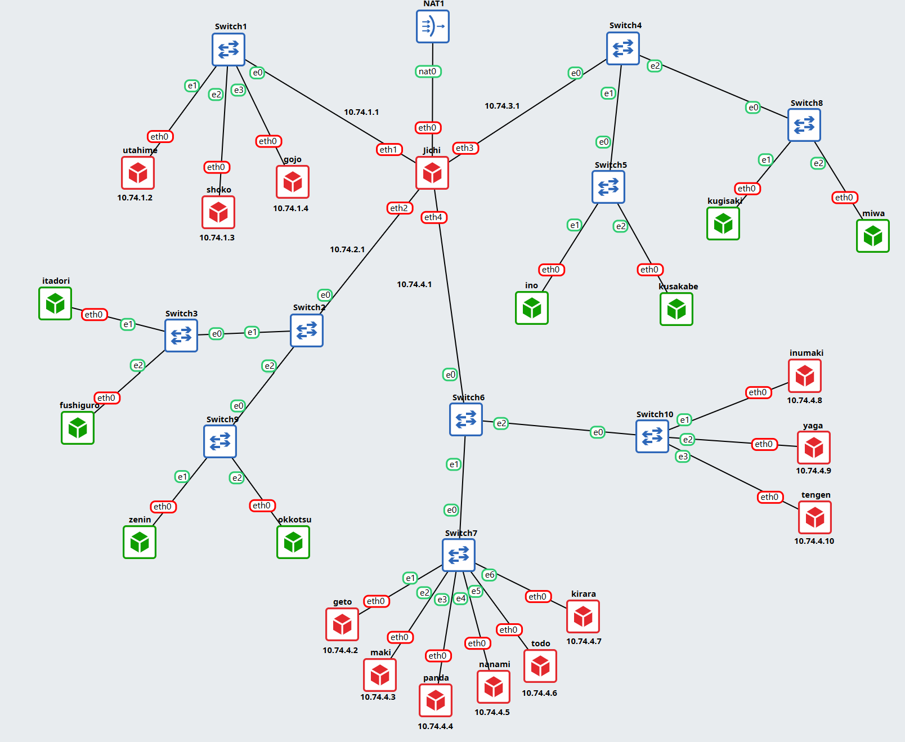

### 1.2.1 Interface jichi
 
| Interface | Terhubung ke | IP Address | Keterangan |
|---|---|---|---|
| eth0 | NAT1 | DHCP | WAN |
| eth1 | Switch1 | 10.74.1.1/24 | Gateway Network 1 (DMZ) |
| eth2 | Switch2 | 10.74.2.1/24 | Gateway Network 2 (Divisi A) |
| eth3 | Switch4 | 10.74.3.1/24 | Gateway Network 3 (Divisi B) |
| eth4 | Switch6 | 10.74.4.1/24 | Gateway Network 4 (Data Center) |
 
### 1.2.2 Host infrastruktur (IP statis)
 
| Host | Peran | Network | IP Address | Gateway |
|---|---|---|---|---|
| utahime | DNS Master | 1 | 10.74.1.2/24 | 10.74.1.1 |
| shoko | DNS Slave | 1 | 10.74.1.3/24 | 10.74.1.1 |
| gojo | Public Reverse Proxy | 1 | 10.74.1.4/24 | 10.74.1.1 |
| geto | Internal Load Balancer | 4 | 10.74.4.2/24 | 10.74.4.1 |
| maki | Worker Frontend | 4 | 10.74.4.3/24 | 10.74.4.1 |
| panda | Worker Frontend | 4 | 10.74.4.4/24 | 10.74.4.1 |
| nanami | Worker API Utama | 4 | 10.74.4.5/24 | 10.74.4.1 |
| todo | Worker API Utama | 4 | 10.74.4.6/24 | 10.74.4.1 |
| kirara | Worker API Cadangan | 4 | 10.74.4.7/24 | 10.74.4.1 |
| inumaki | Database Slave | 4 | 10.74.4.8/24 | 10.74.4.1 |
| yaga | Database Master | 4 | 10.74.4.9/24 | 10.74.4.1 |
| tengen | DHCP Server | 4 | 10.74.4.10/24 | 10.74.4.1 |
 
## 1.3 Langkah Konfigurasi
 
### 1.3.1 Konfigurasi jichi
 
Berkas `/etc/network/interfaces`:
 
```bash
auto eth0
iface eth0 inet dhcp
  up sysctl -w net.ipv4.ip_forward=1
  up iptables -t nat -A POSTROUTING -o eth0 -s 10.74.0.0/16 -j MASQUERADE
 
auto eth1
iface eth1 inet static
  address 10.74.1.1
  netmask 255.255.255.0
 
auto eth2
iface eth2 inet static
  address 10.74.2.1
  netmask 255.255.255.0
 
auto eth3
iface eth3 inet static
  address 10.74.3.1
  netmask 255.255.255.0
 
auto eth4
iface eth4 inet static
  address 10.74.4.1
  netmask 255.255.255.0
```
 
Penjelasan:
 
- `net.ipv4.ip_forward=1` membuat jichi meneruskan paket antar-interface sehingga berfungsi sebagai router.
- Aturan `MASQUERADE` pada chain `POSTROUTING` (tabel `nat`) mengubah alamat sumber paket dari `10.74.0.0/16` menjadi IP `eth0` saat keluar ke NAT (source NAT). `MASQUERADE` dipilih karena IP `eth0` diperoleh dari DHCP dan bisa berubah.
Instalasi iptables:
 
```bash
apt update && apt install -y iptables
```
 
### 1.3.2 Nameserver sementara (jichi dan seluruh node Debinet)
 
Sesuai persyaratan, nameserver `192.168.122.1` dipakai pada persiapan awal agar node dapat mengunduh paket:
 
```bash
cat <<EOF > /root/.bashrc
echo "nameserver 192.168.122.1" > /etc/resolv.conf
EOF
```
 
### 1.3.3 Konfigurasi IP statis host
 
Format `/etc/network/interfaces` (nilai `address` dan `gateway` mengikuti tabel 1.2.2):
 
```bash
# UTAHIME
auto eth0
iface eth0 inet static
  address 10.74.1.2
  netmask 255.255.255.0
  gateway 10.74.1.1
 
# SHOKO
auto eth0
iface eth0 inet static
  address 10.74.1.3
  netmask 255.255.255.0
  gateway 10.74.1.1
 
# GOJO
auto eth0
iface eth0 inet static
  address 10.74.1.4
  netmask 255.255.255.0
  gateway 10.74.1.1
 
# GETO
auto eth0
iface eth0 inet static
  address 10.74.4.2
  netmask 255.255.255.0
  gateway 10.74.4.1
 
# MAKI
auto eth0
iface eth0 inet static
  address 10.74.4.3
  netmask 255.255.255.0
  gateway 10.74.4.1
 
# PANDA
auto eth0
iface eth0 inet static
  address 10.74.4.4
  netmask 255.255.255.0
  gateway 10.74.4.1
 
# NANAMI
auto eth0
iface eth0 inet static
  address 10.74.4.5
  netmask 255.255.255.0
  gateway 10.74.4.1
 
# TODO
auto eth0
iface eth0 inet static
  address 10.74.4.6
  netmask 255.255.255.0
  gateway 10.74.4.1
 
# KIRARA
auto eth0
iface eth0 inet static
  address 10.74.4.7
  netmask 255.255.255.0
  gateway 10.74.4.1
 
# INUMAKI
auto eth0
iface eth0 inet static
  address 10.74.4.8
  netmask 255.255.255.0
  gateway 10.74.4.1
 
# YAGA
auto eth0
iface eth0 inet static
  address 10.74.4.9
  netmask 255.255.255.0
  gateway 10.74.4.1
 
# TENGEN
auto eth0
iface eth0 inet static
  address 10.74.4.10
  netmask 255.255.255.0
  gateway 10.74.4.1
```
## 1.4 Pengujian dan Pembuktian
 
### 1.4.2 Tes dari jichi
 
```bash
ping -c 2 10.74.1.1
ping -c 2 10.74.2.1
ping -c 2 10.74.3.1
ping -c 2 10.74.4.1
ping -c 2 8.8.8.8
ping -c 2 google.com
```

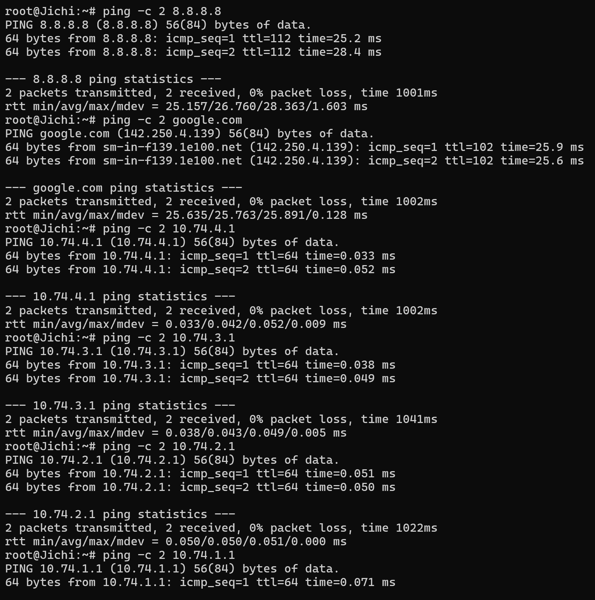

### 1.4.2 Tes dari todo
```bash
ping -c 2 10.74.4.1     # gateway
ping -c 2 8.8.8.8       # akses eksternal melalui NAT
ping -c 2 google.com    # resolusi DNS
```
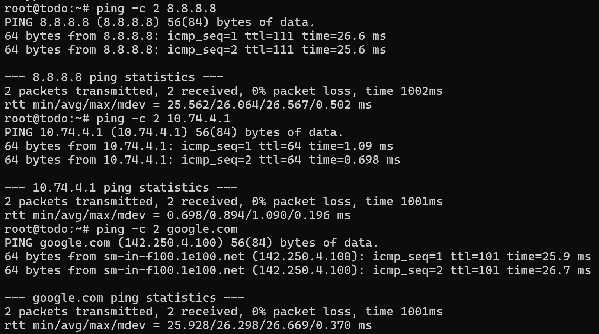


## 2
**Konfigurasikan isc-dhcp-server pada [PREFIX IP].4.10. Deklarasikan Network 4 ([PREFIX IP].4.0/24) sebagai subnet lokal tanpa pool dinamis, lalu siapkan scope DHCP untuk Network 2 ([PREFIX IP].2.0/24) dan Network 3 ([PREFIX IP].3.0/24). Validasi konfigurasi dan pastikan service aktif tanpa error “No subnet declaration”**

## 2.1 Tujuan
 
1. Mengonfigurasi **isc-dhcp-server** pada **tengen** (`10.74.4.10`).
2. Mendeklarasikan **Network 4** (`10.74.4.0/24`) sebagai subnet lokal **tanpa pool dinamis**.
3. Menyiapkan scope DHCP untuk **Network 2** (`10.74.2.0/24`) dan **Network 3** (`10.74.3.0/24`).
4. Memvalidasi konfigurasi dan memastikan service aktif tanpa error **"No subnet declaration"**.
## 2.2 Tabel Rancangan
 
| Parameter | Network 4 | Network 2 | Network 3 |
|---|---|---|---|
| Peran | Subnet lokal tengen | Divisi A | Divisi B |
| Subnet | 10.74.4.0/24 | 10.74.2.0/24 | 10.74.3.0/24 |
| Pool dinamis | Tidak ada | 10.74.2.10 - 10.74.2.100 | 10.74.3.10 - 10.74.3.100 |
| Gateway (`routers`) | - | 10.74.2.1 | 10.74.3.1 |
| Broadcast | - | 10.74.2.255 | 10.74.3.255 |
| DNS | - | 10.74.1.2, 10.74.1.3 | 10.74.1.2, 10.74.1.3 |
 
Parameter umum: `default-lease-time 600`, `max-lease-time 7200`, `authoritative`.
 
## 2.3 Langkah Konfigurasi
 
Seluruh konfigurasi dibuat dalam satu script `/root/setup_tengen.sh` yang menjalankan setiap langkah hanya jika belum dikerjakan.
 
### 2.3.1 Instalasi isc-dhcp-server

 
```bash
  apt-get install -y isc-dhcp-server
```
 
### 2.3.2 Menentukan interface DHCP
 
Berkas `/etc/default/isc-dhcp-server` diatur agar server mendengarkan permintaan DHCP pada `eth0`:
 
```bash
cat <<'EOF' > /etc/default/isc-dhcp-server
INTERFACESv4="eth0"
INTERFACESv6=""
EOF
```
 
### 2.3.3 Konfigurasi `dhcpd.conf`
 
```bash
cat <<'EOF' > /etc/dhcp/dhcpd.conf
default-lease-time 600;
max-lease-time 7200;
authoritative;
 
# Network 4 - subnet lokal tengen, TANPA pool dinamis
subnet 10.74.4.0 netmask 255.255.255.0 {
}
 
# Network 2 - Divisi A (lewat DHCP relay)
subnet 10.74.2.0 netmask 255.255.255.0 {
  range 10.74.2.10 10.74.2.100;
  option routers 10.74.2.1;
  option broadcast-address 10.74.2.255;
  option domain-name-servers 10.74.1.2, 10.74.1.3;
}
 
# Network 3 - Divisi B (lewat DHCP relay)
subnet 10.74.3.0 netmask 255.255.255.0 {
  range 10.74.3.10 10.74.3.100;
  option routers 10.74.3.1;
  option broadcast-address 10.74.3.255;
  option domain-name-servers 10.74.1.2, 10.74.1.3;
}
EOF
```
 
Penjelasan:
 
- **Blok Network 4 dibiarkan kosong.** Server mencari deklarasi subnet yang cocok dengan IP interface `eth0` (10.74.4.10). Jika tidak ada, muncul error *"No subnet declaration for eth0"*. Blok tanpa `range` memenuhi syarat itu tanpa membagikan IP di Network 4, karena host di sana memakai IP statis.
- **Scope Network 2 dan 3** disiapkan untuk klien yang meminta alamat melalui DHCP relay (jichi). Opsi `routers` diisi gateway tiap network.

### 2.3.4 File lease dan menjalankan service
 
```bash
mkdir -p /var/lib/dhcp
[ -f /var/lib/dhcp/dhcpd.leases ] || touch /var/lib/dhcp/dhcpd.leases
 
dhcpd -t -cf /etc/dhcp/dhcpd.conf
service isc-dhcp-server restart
service isc-dhcp-server status
```
 
- File `dhcpd.leases` harus ada agar service bisa start, khususnya di container.
- `dhcpd -t` memvalidasi sintaks konfigurasi sebelum service dijalankan ulang.
 
## 2.4 Validasi
 
```bash
dhcpd -t -cf /etc/dhcp/dhcpd.conf
ps aux | grep dhcpd
service isc-dhcp-server status
```
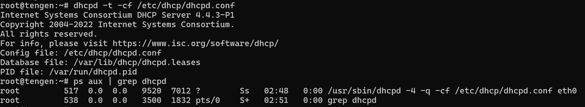

## 3
**Permintaan alamat dari Divisi A dan Divisi B tidak dapat menyeberangi subnet secara langsung. Konfigurasikan jichi sebagai DHCP Relay menuju tengen ([PREFIX IP].4.10), menggunakan eth2 untuk Network 2 dan eth3 untuk Network 3. Buktikan bahwa client dari kedua subnet berhasil memperoleh lease melalui relay.**

## 3.1 Tujuan
 
1. Mengonfigurasi **jichi** sebagai **DHCP Relay** menuju **tengen** (`10.74.4.10`).
2. Menggunakan **eth2** untuk Network 2 (Divisi A) dan **eth3** untuk Network 3 (Divisi B).
3. Membuktikan bahwa klien dari kedua subnet berhasil memperoleh lease melalui relay.
## 3.2 Latar Belakang
 
Klien meminta alamat IP dengan paket **broadcast** (`DHCPDISCOVER`). Broadcast hanya menjangkau satu subnet dan tidak diteruskan oleh router. Karena DHCP Server (tengen) berada di Network 4, permintaan dari Network 2 dan 3 tidak dapat menjangkaunya secara langsung.
 
DHCP Relay pada jichi menyelesaikan masalah ini:
 
```
klien (Net 2/3) --broadcast--> jichi (relay) --unicast--> tengen (10.74.4.10)
klien (Net 2/3) <--balasan---- jichi (relay) <--unicast-- tengen
```
 
Saat meneruskan paket, relay mengisi kolom `giaddr` dengan alamat interface-nya sendiri (`10.74.2.1` atau `10.74.3.1`). Tengen memakai `giaddr` itu untuk memilih scope yang sesuai (Network 2 atau Network 3).
 
## 3.3 Tabel Rancangan
 
| Parameter | Nilai |
|---|---|
| Node relay | jichi |
| DHCP Server tujuan | tengen, `10.74.4.10` |
| Interface sisi klien | eth2 (Network 2), eth3 (Network 3) |
| Interface jalur ke server | eth4 (Network 4) |
| Paket | `isc-dhcp-relay` |
| Berkas konfigurasi | `/etc/default/isc-dhcp-relay` |
 
## 3.4 Langkah Konfigurasi di jichi
 
Konfigurasi disimpan dalam script `/root/setup_jichi.sh`
 
### 3.4.1 Instalasi isc-dhcp-relay
 
```bash
  DEBIAN_FRONTEND=noninteractive apt-get install -y isc-dhcp-relay 
```
 
`DEBIAN_FRONTEND=noninteractive` mencegah instalasi berhenti untuk menanyakan konfigurasi secara interaktif.
 
### 3.4.2 Konfigurasi relay
 
```bash
cat <<'EOF' > /etc/default/isc-dhcp-relay
SERVERS="10.74.4.10"
INTERFACES="eth2 eth3 eth4"
OPTIONS=""
EOF
```
 
Penjelasan:
 
- `SERVERS` adalah alamat DHCP Server tujuan penerusan, yaitu tengen.
- `INTERFACES` berisi interface tempat relay mendengarkan. **eth2** dan **eth3** menerima broadcast dari klien Network 2 dan 3. **eth4** adalah jalur ke tengen sehingga balasan dari server dapat diterima dan diteruskan kembali ke klien.

### 3.4.3 Menjalankan service
 
```bash
service isc-dhcp-relay restart
service isc-dhcp-relay status
ps aux | grep '[d]hcrelay'
```
 
 
## 3.5 Pembuktian
 
### 3.5.1 Relay aktif di jichi
 
```bash
ps aux | grep '[d]hcrelay'
```
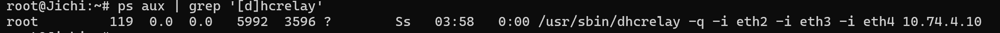

### 3.5.2 Klien meminta IP
 
Dijalankan pada klien Alpine di masing-masing network:
 
```bash
udhcpc -i eth0
ip a
ip route
```
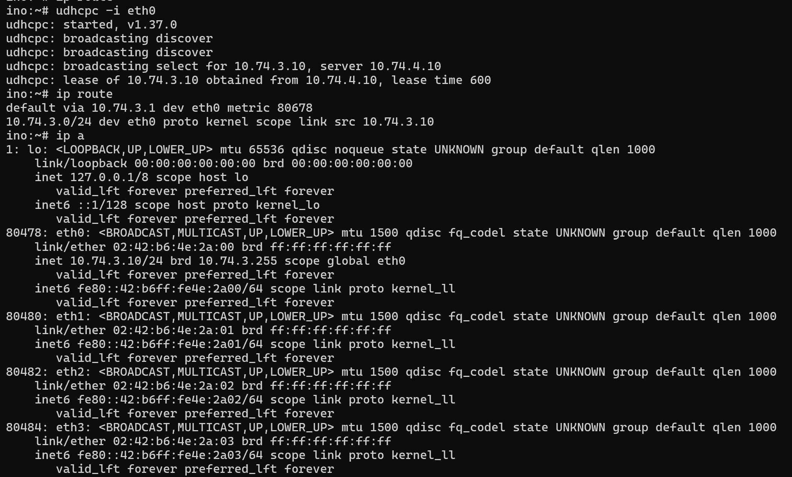

#### PENAMBAHAN KONFIGURASI DI SETIAP CLIENT ALPINET
```bash
   auto eth0
   iface eth0 inet dhcp
```


## 4
**Agar tim Dev dan Support di Divisi A menerima jatah alamat yang berbeda, atur dua pool DHCP pada Network 2. Tetapkan Pool 1 ([PREFIX IP].2.10–[PREFIX IP].2.35) untuk itadori dan fushiguro, serta Pool 2 ([PREFIX IP].2.70–[PREFIX IP].2.95) untuk zenin dan okkotsu. Rentang [PREFIX IP].2.36–[PREFIX IP].2.69 tidak boleh dialokasikan. Karena seluruh client berada pada subnet yang sama, gunakan DHCP class berdasarkan MAC Address atau Client ID untuk memisahkan kedua kelompok.**

## 4.1 Tujuan

1. Membuat dua pool DHCP pada **Network 2** (`10.74.2.0/24`) agar tim Dev dan tim Support menerima rentang alamat yang berbeda.
2. Memisahkan klien dengan **DHCP class** berdasarkan **MAC Address**, karena seluruh klien berada pada subnet yang sama.
3. Memastikan rentang `10.74.2.36 - 10.74.2.69` **tidak dialokasikan** kepada klien mana pun.
4. Membuktikan setiap klien memperoleh IP sesuai pool kelompoknya.

## 4.2 Tabel Rancangan

| Pool | Tim | Klien | Rentang IP |
|---|---|---|---|
| Pool 1 | Dev | itadori, fushiguro | 10.74.2.10 - 10.74.2.35 |
| Pool 2 | Support | zenin, okkotsu | 10.74.2.70 - 10.74.2.95 |
| Tidak dialokasikan | - | - | 10.74.2.36 - 10.74.2.69 |

### 4.2.1 MAC Address klien

| Pool | Klien | MAC Address |
|---|---|---|
| Pool 1 | itadori | `02:42:be:59:63:00` |
| Pool 1 | fushiguro | `02:42:58:39:03:00` |
| Pool 2 | zenin | `02:42:93:36:d2:00` |
| Pool 2 | okkotsu | `02:42:6b:dc:19:00` |

MAC diperoleh dengan menjalankan perintah berikut pada setiap klien (nilai setelah `link/ether`):

```bash
ip link show eth0
```

## 4.3 Langkah Konfigurasi ke `/etc/dhcp/dhcpd.conf (tengen)`

### 4.3.1 Class berdasarkan MAC Address

Setiap kelompok didefinisikan sebagai `class`. Klien dikenali dari 6 byte MAC yang dikirim pada paket DHCP.

```bash
class "pool1" {
  match if (substring(hardware, 1, 6) = 02:42:be:59:63:00
         or substring(hardware, 1, 6) = 02:42:58:39:03:00);
}

class "pool2" {
  match if (substring(hardware, 1, 6) = 02:42:93:36:d2:00
         or substring(hardware, 1, 6) = 02:42:6b:dc:19:00);
}
```

Fungsi `substring(hardware, 1, 6)` mengambil 6 byte MAC. Byte pertama pada `hardware` adalah tipe perangkat keras, sehingga pengambilan dimulai dari posisi 1.

### 4.3.2 Dua pool pada Network 2

```bash
subnet 10.74.2.0 netmask 255.255.255.0 {
  option routers 10.74.2.1;
  option broadcast-address 10.74.2.255;
  option domain-name-servers 10.74.1.2, 10.74.1.3;

  pool {
    range 10.74.2.10 10.74.2.35;
    allow members of "pool1";
  }

  pool {
    range 10.74.2.70 10.74.2.95;
    allow members of "pool2";
  }
}
```

Penjelasan:

- `allow members of "pool1"` membatasi pool hanya untuk klien yang masuk class tersebut. Hal yang sama berlaku untuk `pool2`.
- Rentang `10.74.2.36 - 10.74.2.69` tidak dimasukkan ke pool mana pun, sehingga tidak pernah dialokasikan.
- Klien yang MAC-nya tidak termasuk kedua class tidak memperoleh IP dari Network 2.

## 4.4 Validasi dan Pembuktian

### 4.4.1 IP yang diperoleh klien

Pada setiap klien Network 2 dijalankan:

```bash
udhcpc -i eth0
ip route
ip a
```

| Klien | Pool | Rentang seharusnya | IP yang diperoleh |
|---|---|---|---|---|
| itadori | Pool 1 | 10.74.2.10 - 10.74.2.35 | 10.74.2.10 | 
| fushiguro | Pool 1 | 10.74.2.10 - 10.74.2.35 |  10.74.2.11 | 
| zenin | Pool 2 | 10.74.2.70 - 10.74.2.95 |  10.74.2.71 | 
| okkotsu | Pool 2 | 10.74.2.70 - 10.74.2.95 |  10.74.2.70 | 


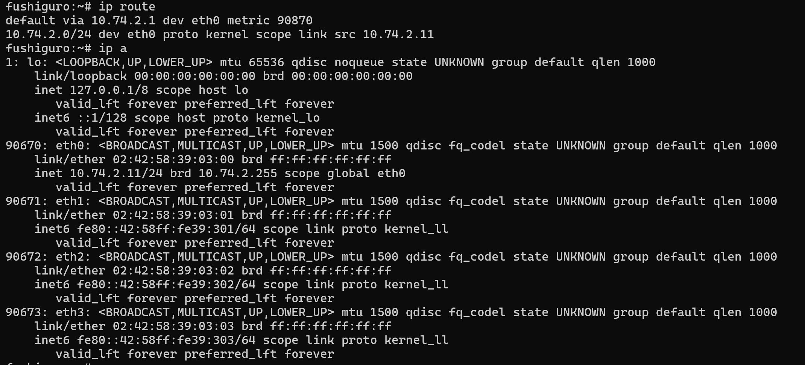
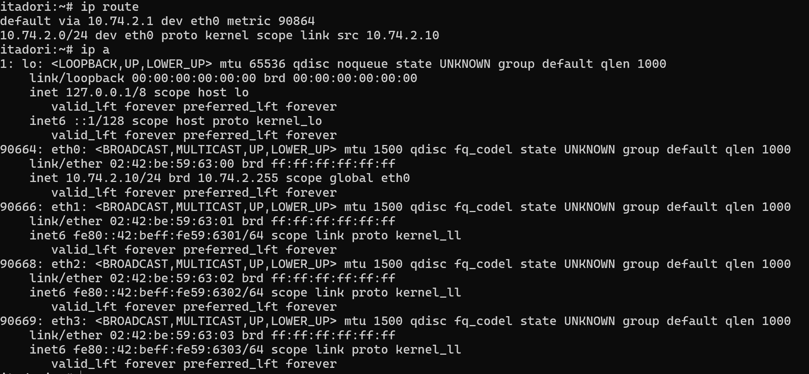
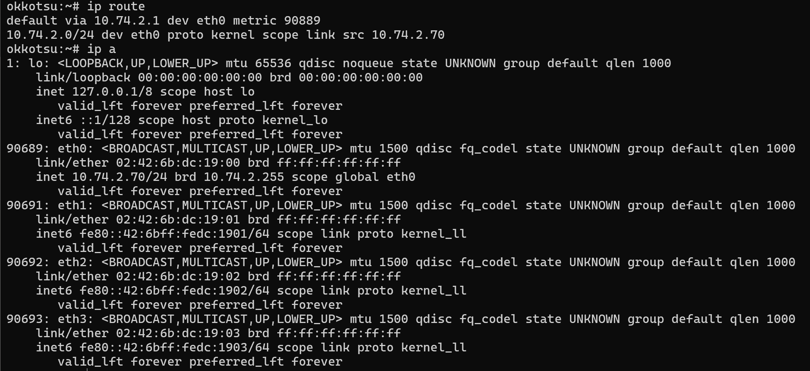
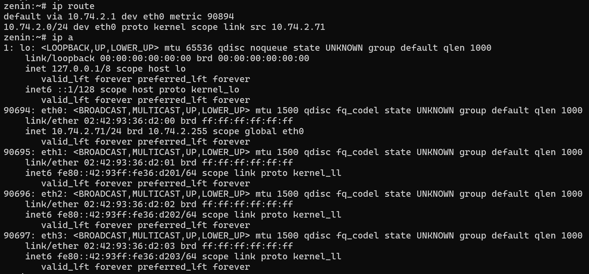

## 5
**Setiap tim lapangan memiliki durasi operasi yang berbeda. Pada Network 3, berikan short lease 30 menit (1800 detik) kepada ino dan kusakabe, serta long lease 12 jam (43200 detik) kepada miwa. Gunakan pool short lease [PREFIX IP].3.10–[PREFIX IP].3.89 dan pool long lease [PREFIX IP].3.100–[PREFIX IP].3.199. Sesuaikan default-lease-time dan max-lease-time untuk setiap kelas client. Berikan pula DHCP options berupa DNS [PREFIX IP].1.2 dan [PREFIX IP].1.3, serta domain-search <xxxx>.com.**

## 5.1 Tujuan

1. Memberikan **short lease 30 menit (1800 detik)** kepada **ino** dan **kusakabe**.
2. Memberikan **long lease 12 jam (43200 detik)** kepada **miwa**.
3. Menggunakan pool short lease `10.74.3.10 - 10.74.3.89` dan pool long lease `10.74.3.100 - 10.74.3.199`.
4. Menyesuaikan `default-lease-time` dan `max-lease-time` untuk setiap kelas klien.
5. Memberikan DHCP options berupa DNS `10.74.1.2` dan `10.74.1.3`, serta `domain-search K-21.com`.

## 5.2 Tabel Rancangan

| Kelompok | Klien | Pool | default-lease-time | max-lease-time |
|---|---|---|---|---|
| short-lease | ino, kusakabe | 10.74.3.10 - 10.74.3.89 | 1800 detik (30 menit) | 1800 detik |
| long-lease | miwa | 10.74.3.100 - 10.74.3.199 | 43200 detik (12 jam) | 43200 detik |


DHCP options untuk seluruh klien:

| Option | Nilai |
|---|---|
| routers | 10.74.3.1 |
| domain-name-servers | 10.74.1.2, 10.74.1.3 |
| domain-search | K-21.com |

### 5.2.1 MAC Address klien Network 3

| Klien | Kelompok | MAC Address |
|---|---|---|
| ino | short-lease | `02:42:b6:4e:2a:00` |
| kusakabe | short-lease | `02:42:da:db:58:00` |
| miwa | long-lease | `02:42:58:d7:86:00` |

MAC diperoleh dengan menjalankan perintah berikut pada setiap klien (nilai setelah `link/ether`):

```bash
ip link show eth0
```

## 5.3 Langkah Konfigurasi

### 5.3.1 Class berdasarkan MAC Address

Karena seluruh klien Network 3 berada pada subnet yang sama, kelompok dibedakan dengan `class` berbasis MAC. Lama lease ditentukan di dalam masing-masing class sehingga hanya berlaku untuk anggotanya.

```bash
class "short-lease" {
  match if (substring(hardware, 1, 6) = 02:42:b6:4e:2a:00
         or substring(hardware, 1, 6) = 02:42:da:db:58:00);
  default-lease-time 1800;
  max-lease-time 1800;
}

class "long-lease" {
  match if (substring(hardware, 1, 6) = 02:42:58:d7:86:00);
  default-lease-time 43200;
  max-lease-time 43200;
}
```

`default-lease-time` dan `max-lease-time` dibuat sama agar klien tidak dapat meminta lease lebih lama dari ketentuan kelasnya.

### 5.3.2 Pool dan options pada Network 3

```bash
option domain-search "K-21.com";

subnet 10.74.3.0 netmask 255.255.255.0 {
  option routers 10.74.3.1;
  option broadcast-address 10.74.3.255;
  option domain-name-servers 10.74.1.2, 10.74.1.3;

  pool {
    range 10.74.3.10 10.74.3.89;
    allow members of "short-lease";
  }

  pool {
    range 10.74.3.100 10.74.3.199;
    allow members of "long-lease";
  }
}
```

Penjelasan:

- `allow members of` membatasi pool agar hanya dipakai oleh klien pada class yang bersangkutan.
- `option domain-search` ditempatkan di luar blok subnet sehingga berlaku untuk seluruh network.
- Klien Network 3 yang MAC-nya tidak termasuk kedua class tidak memperoleh IP dari pool ini.


## 5.4 Validasi dan Pembuktian

### 5.4.1 IP dan lease time yang diperoleh klien

Pada ino, kusakabe, dan miwa dijalankan:

```bash
ip route
ip a
cat /etc/resolv.conf
udhcpc -i eth0
```

Pada tengen dijalankan:

```bash
cat /var/lib/dhcp/dhcpd.leases
```

| Klien | Kelompok | Rentang seharusnya | IP yang diperoleh | Lease time | 
|---|---|---|---|---|---|
| ino | short-lease | 10.74.3.10 - 10.74.3.89 | 10.74.3.10  | 1800 atau 30 menit | 
| kusakabe | short-lease | 10.74.3.10 - 10.74.3.89 | 10.74.3.12  | 1800 atau 30 menit | 
| miwa | long-lease | 10.74.3.100 - 10.74.3.199 | 10.74.3.100 | 43200 | 

Pada `ip route`, klien seharusnya memiliki default route melalui `10.74.3.1`. Pada `/etc/resolv.conf`, nameserver seharusnya memuat `10.74.1.2` dan `10.74.1.3`.
- ino 

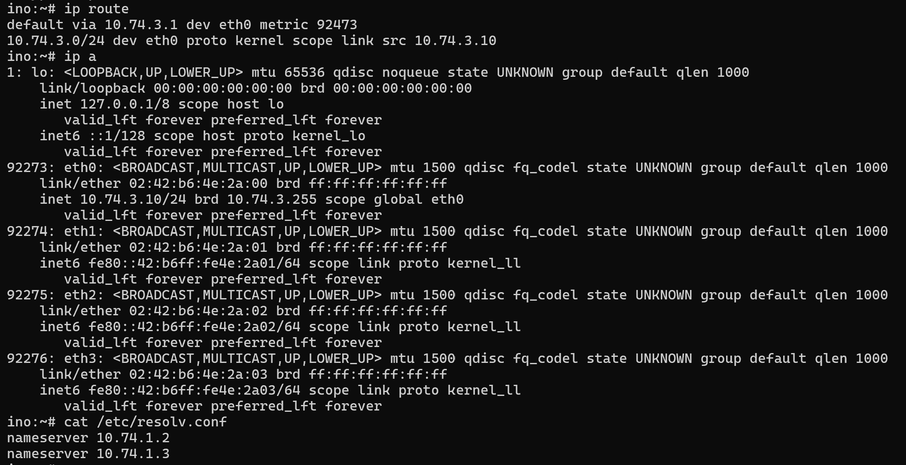
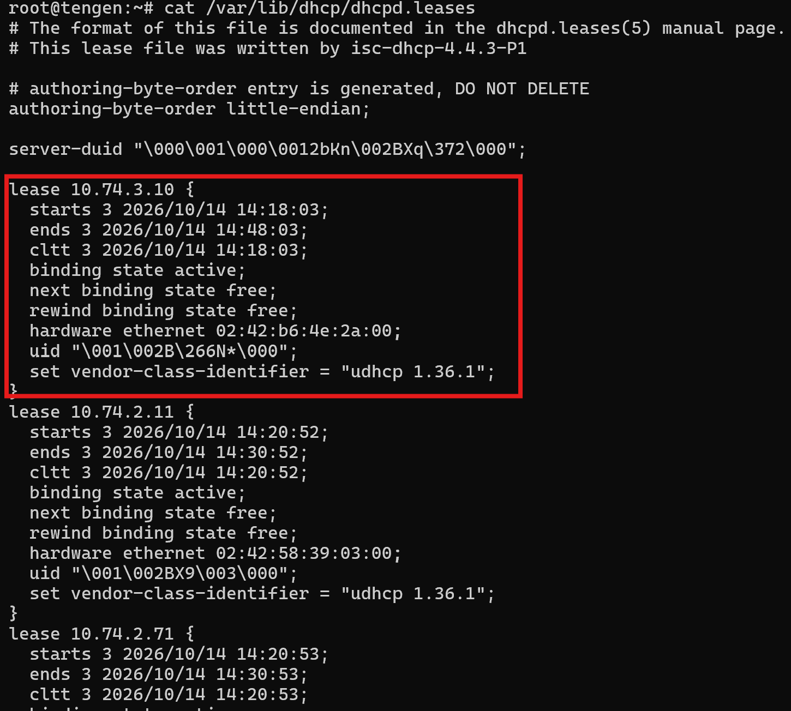

- kukasabe

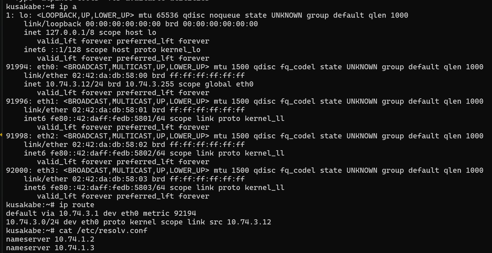
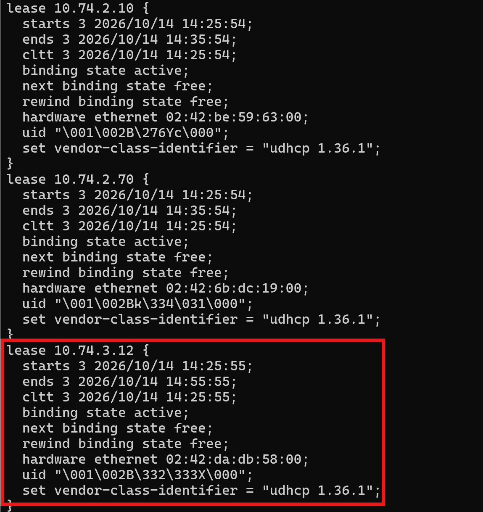

- miwa 

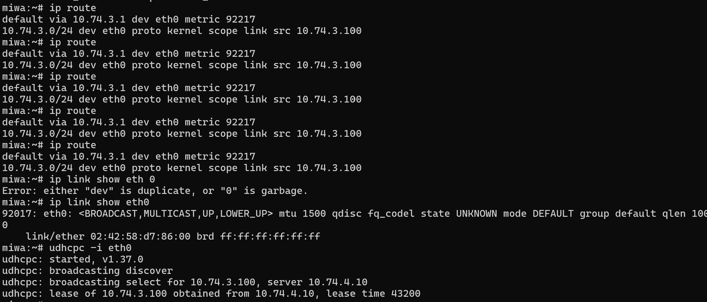


## 6
**Kugisaki ditetapkan sebagai personel VIP yang harus mempertahankan alamat yang sama setiap kali terhubung. Buat DHCP static lease berdasarkan MAC Address client tersebut dengan fixed address [PREFIX IP].3.99. Pastikan alamat ini berada di luar seluruh pool dinamis, validasi konfigurasi server, lalu renew lease pada client. Buktikan bahwa alamat yang diterima sesuai dengan reservasi.**

## 6.1 Tujuan

1. Membuat **DHCP static lease** berdasarkan MAC Address kugisaki dengan **fixed address `10.74.3.99`**, sehingga kugisaki selalu memperoleh alamat yang sama setiap kali terhubung.
2. Memastikan alamat `10.74.3.99` berada **di luar seluruh pool dinamis**.
3. Memvalidasi konfigurasi server, lalu melakukan **renew lease** pada klien.
4. Membuktikan alamat yang diterima sesuai dengan reservasi.

## 6.2 Tabel Rancangan

| Parameter | Nilai |
|---|---|
| Klien | kugisaki |
| Network | Network 3 (Divisi B), `10.74.3.0/24` |
| MAC Address | `02:42:7c:b4:fc:00` |
| Fixed address | `10.74.3.99` |
| Gateway | `10.74.3.1` |
| DHCP Server | tengen, `10.74.4.10` (melalui DHCP Relay jichi) |

## 6.3 Perubahan yang Ditambahkan

Perubahan hanya dilakukan pada **tengen**. Jichi (relay) dan klien lain tidak diubah.

| No | Bagian | Perubahan |
|---|---|---|
| 1 | Variabel script | Menambah `MAC_KUGISAKI="02:42:7c:b4:fc:00"` |
| 2 | Daftar pengecekan penulisan config | Menambah `$MAC_KUGISAKI` pada perulangan `for M in ...` agar `dhcpd.conf` ditulis ulang otomatis |
| 3 | `dhcpd.conf`, subnet Network 3 | Menambah blok `host kugisaki` dengan `hardware ethernet` dan `fixed-address 10.74.3.99` |

Blok yang ditambahkan pada subnet Network 3:

```bash
# Static lease kugisaki (VIP): 10.74.3.99 berada di luar seluruh pool
host kugisaki {
  hardware ethernet 02:42:7c:b4:fc:00;
  fixed-address 10.74.3.99;
}
```

## 6.4  Konfigurasi

### 6.4.1 Mengambil MAC Address kugisaki

Pada kugisaki:

```bash
ip link show eth0
```

Hasil: `link/ether 02:42:7c:b4:fc:00`.

### 6.4.2 Deklarasi host

```bash
subnet 10.74.3.0 netmask 255.255.255.0 {
  option routers 10.74.3.1;
  option broadcast-address 10.74.3.255;
  option domain-name-servers 10.74.1.2, 10.74.1.3;

  pool {
    range 10.74.3.10 10.74.3.89;
    allow members of "short-lease";
  }

  pool {
    range 10.74.3.100 10.74.3.199;
    allow members of "long-lease";
  }

  host kugisaki {
    hardware ethernet 02:42:7c:b4:fc:00;
    fixed-address 10.74.3.99;
  }
}
```

Penjelasan:

- Deklarasi `host` membuat server langsung memberikan alamat yang tertulis ketika menerima permintaan dari MAC tersebut, tanpa memilih dari pool.
- Blok ditempatkan di dalam subnet Network 3, sehingga kugisaki mewarisi `routers`, `broadcast-address`, dan `domain-name-servers` milik Network 3.
- Kugisaki tidak termasuk class `short-lease` maupun `long-lease`. Alamatnya berasal dari reservasi, bukan dari pool.
- Lama lease kugisaki memakai nilai global (`default-lease-time 600`) karena soal tidak menetapkan durasi khusus untuk reservasi.

### 6.4.3 Script `setup_tengen.sh`

```bash
#!/bin/bash
# TENGEN - DHCP Server (isc-dhcp-server) 10.74.4.10

KELOMPOK="K-21"

# MAC ADDRESS KLIEN NETWORK 2
MAC_ITADORI="02:42:be:59:63:00"
MAC_FUSHIGURO="02:42:58:39:03:00"
MAC_ZENIN="02:42:93:36:d2:00"
MAC_OKKOTSU="02:42:6b:dc:19:00"

# MAC ADDRESS KLIEN NETWORK 3
MAC_INO="02:42:b6:4e:2a:00"
MAC_KUSAKABE="02:42:da:db:58:00"
MAC_MIWA="02:42:58:d7:86:00"
MAC_KUGISAKI="02:42:7c:b4:fc:00"

# Pastikan eth0 punya IP statis tengen dan rute default ke jichi
if ! ip -4 addr show eth0 | grep -q '10.74.4.10/24'; then
  ip addr add 10.74.4.10/24 dev eth0 2>/dev/null
  ip link set eth0 up
fi
ip route replace default via 10.74.4.1

# Install jika belum terpasang
if ! dpkg -s isc-dhcp-server >/dev/null 2>&1; then
  apt-get update >/dev/null 2>&1
  apt-get install -y isc-dhcp-server >/dev/null 2>&1
fi

# Interface DHCP
if ! grep -q '^INTERFACESv4="eth0"' /etc/default/isc-dhcp-server 2>/dev/null; then
  cat <<'EOF' > /etc/default/isc-dhcp-server
INTERFACESv4="eth0"
INTERFACESv6=""
EOF
fi

# File lease
mkdir -p /var/lib/dhcp
[ -f /var/lib/dhcp/dhcpd.leases ] || touch /var/lib/dhcp/dhcpd.leases

# dhcpd.conf: ditulis ulang jika belum memuat semua MAC dan domain-search kelompok
ADA=1
for M in $MAC_ITADORI $MAC_FUSHIGURO $MAC_ZENIN $MAC_OKKOTSU $MAC_INO $MAC_KUSAKABE $MAC_MIWA $MAC_KUGISAKI "$KELOMPOK.com"; do
  grep -q "$M" /etc/dhcp/dhcpd.conf 2>/dev/null || ADA=0
done

if [ "$ADA" = 0 ]; then
  service isc-dhcp-server stop >/dev/null 2>&1
  : > /var/lib/dhcp/dhcpd.leases   # kosongkan lease lama agar pengujian bersih
  cat <<EOF > /etc/dhcp/dhcpd.conf
default-lease-time 600;
max-lease-time 7200;
authoritative;

option domain-search "$KELOMPOK.com";

# Class Network 2: Pool 1 (itadori, fushiguro) dan Pool 2 (zenin, okkotsu)
class "pool1" {
  match if (substring(hardware, 1, 6) = $MAC_ITADORI
         or substring(hardware, 1, 6) = $MAC_FUSHIGURO);
}

class "pool2" {
  match if (substring(hardware, 1, 6) = $MAC_ZENIN
         or substring(hardware, 1, 6) = $MAC_OKKOTSU);
}

# Class Network 3: short lease 30 menit (ino, kusakabe), long lease 12 jam (miwa)
class "short-lease" {
  match if (substring(hardware, 1, 6) = $MAC_INO
         or substring(hardware, 1, 6) = $MAC_KUSAKABE);
  default-lease-time 1800;
  max-lease-time 1800;
}

class "long-lease" {
  match if (substring(hardware, 1, 6) = $MAC_MIWA);
  default-lease-time 43200;
  max-lease-time 43200;
}

# Network 4 - subnet lokal tengen, TANPA pool dinamis
subnet 10.74.4.0 netmask 255.255.255.0 {
}

# Network 2 - Divisi A (lewat DHCP relay)
# Rentang 10.74.2.36 - 10.74.2.69 tidak dialokasikan
subnet 10.74.2.0 netmask 255.255.255.0 {
  option routers 10.74.2.1;
  option broadcast-address 10.74.2.255;
  option domain-name-servers 10.74.1.2, 10.74.1.3;

  pool {
    range 10.74.2.10 10.74.2.35;
    allow members of "pool1";
  }

  pool {
    range 10.74.2.70 10.74.2.95;
    allow members of "pool2";
  }
}

# Network 3 - Divisi B (lewat DHCP relay)
subnet 10.74.3.0 netmask 255.255.255.0 {
  option routers 10.74.3.1;
  option broadcast-address 10.74.3.255;
  option domain-name-servers 10.74.1.2, 10.74.1.3;

  pool {
    range 10.74.3.10 10.74.3.89;
    allow members of "short-lease";
  }

  pool {
    range 10.74.3.100 10.74.3.199;
    allow members of "long-lease";
  }

  # Static lease kugisaki (VIP): 10.74.3.99 berada di luar seluruh pool
  host kugisaki {
    hardware ethernet $MAC_KUGISAKI;
    fixed-address 10.74.3.99;
  }
}
EOF
fi

# Validasi lalu jalankan service
dhcpd -t -cf /etc/dhcp/dhcpd.conf
rm -f /var/run/dhcpd.pid
service isc-dhcp-server restart
service isc-dhcp-server status
ps aux | grep '[d]hcpd'
```

Catatan: lease lama dikosongkan saat konfigurasi ditulis ulang agar pengujian tidak terpengaruh lease sebelumnya.

## 6.5 Pembuktian

### 6.5.1 Renew lease pada kugisaki

Perintah pada kugisaki:

```bash
udhcpc -i eth0
ip a
ip route
```
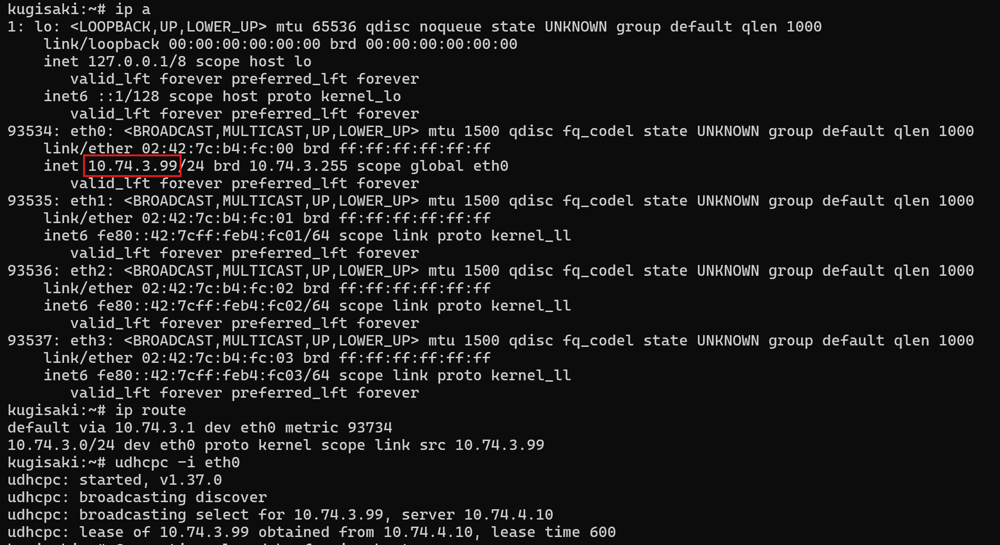


## 7
**Setelah aturan alokasi diterapkan, pastikan setiap client menerima konfigurasi jaringan sesuai wilayahnya: subnet mask 255.255.255.0 (/24), gateway dan broadcast address yang benar, DNS [PREFIX IP].1.2 serta [PREFIX IP].1.3, dan domain-search yang ditentukan. Periksa IP address dan routing seluruh client Divisi A dan Divisi B, kemudian cocokkan lease dengan /var/lib/dhcp/dhcpd.leases pada tengen. Pastikan tidak ada alamat yang bertabrakan atau berada di luar kebijakan pool.**

## 7.1 Tujuan
 
Setelah seluruh aturan alokasi DHCP diterapkan, dilakukan pemeriksaan bahwa setiap klien menerima konfigurasi jaringan sesuai wilayahnya:
 
1. Subnet mask `255.255.255.0` (/24).
2. Gateway dan broadcast address yang benar.
3. DNS `10.74.1.2` dan `10.74.1.3`.
4. Domain-search yang ditentukan (`K-21.com`).
5. IP address dan routing seluruh klien Divisi A dan Divisi B diperiksa, kemudian dicocokkan dengan `/var/lib/dhcp/dhcpd.leases` pada tengen.
6. Tidak ada alamat yang bertabrakan atau berada di luar kebijakan pool.
## 7.2 Tabel Rancangan
 
 
### 7.2.1 Kebijakan alokasi per klien
 
| Divisi | Klien | MAC Address | Kebijakan | Rentang yang diizinkan | Lease time |
|---|---|---|---|---|---|
| A | itadori | `02:42:be:59:63:00` | Pool 1 | 10.74.2.10 - 10.74.2.35 | 600 detik |
| A | fushiguro | `02:42:58:39:03:00` | Pool 1 | 10.74.2.10 - 10.74.2.35 | 600 detik |
| A | zenin | `02:42:93:36:d2:00` | Pool 2 | 10.74.2.70 - 10.74.2.95 | 600 detik |
| A | okkotsu | `02:42:6b:dc:19:00` | Pool 2 | 10.74.2.70 - 10.74.2.95 | 600 detik |
| B | ino | `02:42:b6:4e:2a:00` | Short lease | 10.74.3.10 - 10.74.3.89 | 1800 detik |
| B | kusakabe | `02:42:da:db:58:00` | Short lease | 10.74.3.10 - 10.74.3.89 | 1800 detik |
| B | miwa | `02:42:58:d7:86:00` | Long lease | 10.74.3.100 - 10.74.3.199 | 43200 detik |
| B | kugisaki | `02:42:7c:b4:fc:00` | Static lease | 10.74.3.99 (reservasi) | 600 detik |
 
Rentang yang tidak boleh dialokasikan secara dinamis: `10.74.2.36 - 10.74.2.69` (Network 2) serta `10.74.3.90 - 10.74.3.99` (Network 3, `10.74.3.99` khusus untuk reservasi kugisaki).
 
## 7.3 Perubahan yang Dilakukan
 
| No | Bagian | Perubahan | Alasan |
|---|---|---|---|
| 1 | `dhcpd.conf`, bagian global | Menambah `option domain-name "K-21.com";` | Pada pengujian sebelumnya, `/etc/resolv.conf` klien hanya memuat baris `nameserver` tanpa baris `search`. Opsi `domain-name` (opsi DHCP nomor 15) diminta klien `udhcpc` secara bawaan, sehingga domain dapat diterima klien. Opsi `domain-search` tetap dipertahankan. |
| 2 | Penanda penulisan config pada `setup_tengen.sh` | Menambah pengecekan `option domain-name` pada perulangan `for M in ...` | Agar `dhcpd.conf` ditulis ulang otomatis ketika opsi baru belum ada |
 
Tidak ada perubahan pada jichi maupun pada klien.
 
## 7.4 Langkah Pemeriksaan
 
### 7.4.1 Script `setup_tengen.sh`
 
```bash
#!/bin/bash
# TENGEN - DHCP Server (isc-dhcp-server) 10.74.4.10
 
KELOMPOK="K-21"
 
# MAC ADDRESS KLIEN NETWORK 2
MAC_ITADORI="02:42:be:59:63:00"
MAC_FUSHIGURO="02:42:58:39:03:00"
MAC_ZENIN="02:42:93:36:d2:00"
MAC_OKKOTSU="02:42:6b:dc:19:00"
 
# MAC ADDRESS KLIEN NETWORK 3
MAC_INO="02:42:b6:4e:2a:00"
MAC_KUSAKABE="02:42:da:db:58:00"
MAC_MIWA="02:42:58:d7:86:00"
MAC_KUGISAKI="02:42:7c:b4:fc:00"
 
# Pastikan eth0 punya IP statis tengen dan rute default ke jichi
if ! ip -4 addr show eth0 | grep -q '10.74.4.10/24'; then
  ip addr add 10.74.4.10/24 dev eth0 2>/dev/null
  ip link set eth0 up
fi
ip route replace default via 10.74.4.1
 
# Install jika belum terpasang
if ! dpkg -s isc-dhcp-server >/dev/null 2>&1; then
  apt-get update >/dev/null 2>&1
  apt-get install -y isc-dhcp-server >/dev/null 2>&1
fi
 
# Interface DHCP
if ! grep -q '^INTERFACESv4="eth0"' /etc/default/isc-dhcp-server 2>/dev/null; then
  cat <<'EOF' > /etc/default/isc-dhcp-server
INTERFACESv4="eth0"
INTERFACESv6=""
EOF
fi
 
# File lease
mkdir -p /var/lib/dhcp
[ -f /var/lib/dhcp/dhcpd.leases ] || touch /var/lib/dhcp/dhcpd.leases
 
# dhcpd.conf: ditulis ulang jika belum memuat semua MAC, domain-search, dan domain-name kelompok
ADA=1
for M in $MAC_ITADORI $MAC_FUSHIGURO $MAC_ZENIN $MAC_OKKOTSU $MAC_INO $MAC_KUSAKABE $MAC_MIWA $MAC_KUGISAKI "$KELOMPOK.com" "option domain-name \"$KELOMPOK.com\""; do
  grep -q "$M" /etc/dhcp/dhcpd.conf 2>/dev/null || ADA=0
done
 
if [ "$ADA" = 0 ]; then
  service isc-dhcp-server stop >/dev/null 2>&1
  : > /var/lib/dhcp/dhcpd.leases   # kosongkan lease lama agar pengujian bersih
  cat <<EOF > /etc/dhcp/dhcpd.conf
default-lease-time 600;
max-lease-time 7200;
authoritative;
 
option domain-search "$KELOMPOK.com";
option domain-name "$KELOMPOK.com";
 
# Class Network 2: Pool 1 (itadori, fushiguro) dan Pool 2 (zenin, okkotsu)
class "pool1" {
  match if (substring(hardware, 1, 6) = $MAC_ITADORI
         or substring(hardware, 1, 6) = $MAC_FUSHIGURO);
}
 
class "pool2" {
  match if (substring(hardware, 1, 6) = $MAC_ZENIN
         or substring(hardware, 1, 6) = $MAC_OKKOTSU);
}
 
# Class Network 3: short lease 30 menit (ino, kusakabe), long lease 12 jam (miwa)
class "short-lease" {
  match if (substring(hardware, 1, 6) = $MAC_INO
         or substring(hardware, 1, 6) = $MAC_KUSAKABE);
  default-lease-time 1800;
  max-lease-time 1800;
}
 
class "long-lease" {
  match if (substring(hardware, 1, 6) = $MAC_MIWA);
  default-lease-time 43200;
  max-lease-time 43200;
}
 
# Network 4 - subnet lokal tengen, TANPA pool dinamis
subnet 10.74.4.0 netmask 255.255.255.0 {
}
 
# Network 2 - Divisi A (lewat DHCP relay)
# Rentang 10.74.2.36 - 10.74.2.69 tidak dialokasikan
subnet 10.74.2.0 netmask 255.255.255.0 {
  option routers 10.74.2.1;
  option broadcast-address 10.74.2.255;
  option domain-name-servers 10.74.1.2, 10.74.1.3;
 
  pool {
    range 10.74.2.10 10.74.2.35;
    allow members of "pool1";
  }
 
  pool {
    range 10.74.2.70 10.74.2.95;
    allow members of "pool2";
  }
}
 
# Network 3 - Divisi B (lewat DHCP relay)
subnet 10.74.3.0 netmask 255.255.255.0 {
  option routers 10.74.3.1;
  option broadcast-address 10.74.3.255;
  option domain-name-servers 10.74.1.2, 10.74.1.3;
 
  pool {
    range 10.74.3.10 10.74.3.89;
    allow members of "short-lease";
  }
 
  pool {
    range 10.74.3.100 10.74.3.199;
    allow members of "long-lease";
  }
 
  # Static lease kugisaki (VIP): 10.74.3.99 berada di luar seluruh pool
  host kugisaki {
    hardware ethernet $MAC_KUGISAKI;
    fixed-address 10.74.3.99;
  }
}
EOF
fi
 
# Validasi lalu jalankan service
dhcpd -t -cf /etc/dhcp/dhcpd.conf
rm -f /var/run/dhcpd.pid
service isc-dhcp-server restart
service isc-dhcp-server status
ps aux | grep '[d]hcpd'
```
 
### 7.4.2 Pemeriksaan pada setiap klien
 
Dijalankan pada kedelapan klien (itadori, fushiguro, zenin, okkotsu, ino, kusakabe, miwa, kugisaki):
 
```bash
udhcpc -i eth0
ip a
ip route
cat /etc/resolv.conf
```
 
- `udhcpc -i eth0` meminta lease baru dan menampilkan lama lease.
- `ip a` menunjukkan IP address, subnet mask (/24), dan broadcast.
- `ip route` menunjukkan gateway (default route).
- `cat /etc/resolv.conf` menunjukkan DNS dan domain-search yang diterima.
### 7.4.3 Pemeriksaan lease pada tengen
 
Dijalankan segera setelah seluruh klien meminta lease:
 
```bash
cat /var/lib/dhcp/dhcpd.leases
```
 
 
## 7.5 Hasil Pemeriksaan
 
### 7.5.1 IP yang diperoleh klien dan kesesuaian dengan pool
 
| Divisi | Klien | IP yang diperoleh | Kebijakan | Rentang yang diizinkan | Sesuai |
|---|---|---|---|---|---|
| A | itadori | 10.74.2.10 | Pool 1 | 10.74.2.10 - 10.74.2.35 | Ya |
| A | fushiguro | 10.74.2.11 | Pool 1 | 10.74.2.10 - 10.74.2.35 | Ya |
| A | okkotsu | 10.74.2.70 | Pool 2 | 10.74.2.70 - 10.74.2.95 | Ya |
| A | zenin | 10.74.2.71 | Pool 2 | 10.74.2.70 - 10.74.2.95 | Ya |
| B | kusakabe | 10.74.3.10 | Short lease | 10.74.3.10 - 10.74.3.89 | Ya |
| B | ino | 10.74.3.11 | Short lease | 10.74.3.10 - 10.74.3.89 | Ya |
| B | miwa | 10.74.3.100 | Long lease | 10.74.3.100 - 10.74.3.199 | Ya |
| B | kugisaki | 10.74.3.99 | Static lease | 10.74.3.99 (reservasi) | Ya |
 
### 7.5.2 Konfigurasi jaringan yang diterima tiap klien
 
Tabel berikut diisi dari hasil `ip a`, `ip route`, dan `cat /etc/resolv.conf` pada tiap klien.
| Klien | IP/prefix | Gateway | Broadcast | Lease time |
|---|---|---|---|---|
| itadori | 10.74.2.10/24 | 10.74.2.1 | 10.74.2.255 | 600 detik (10 menit) |
| fushiguro | 10.74.2.11/24 | 10.74.2.1 | 10.74.2.255 | 600 detik (10 menit) |
| zenin | 10.74.2.71/24 | 10.74.2.1 | 10.74.2.255 | 600 detik (10 menit) |
| okkotsu | 10.74.2.70/24 | 10.74.2.1 | 10.74.2.255 | 600 detik (10 menit) |
| ino | 10.74.3.11/24 | 10.74.3.1 | 10.74.3.255 | 1800 detik (30 menit) |
| kusakabe | 10.74.3.10/24 | 10.74.3.1 | 10.74.3.255 | 1800 detik (30 menit) |
| miwa | 10.74.3.100/24 | 10.74.3.1 | 10.74.3.255 | 43200 detik (12 jam) |
| kugisaki | 10.74.3.99/24 | 10.74.3.1 | 10.74.3.255 | _(tidak tersedia)_ |
 
 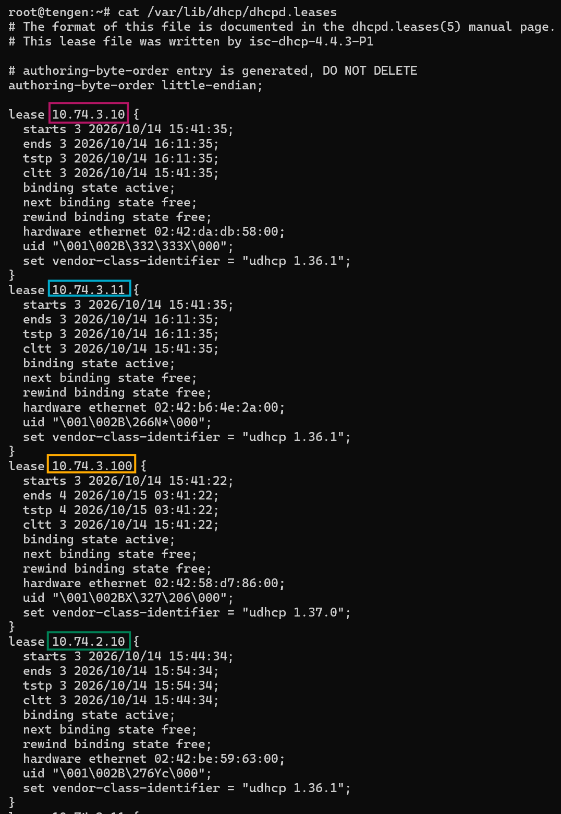
 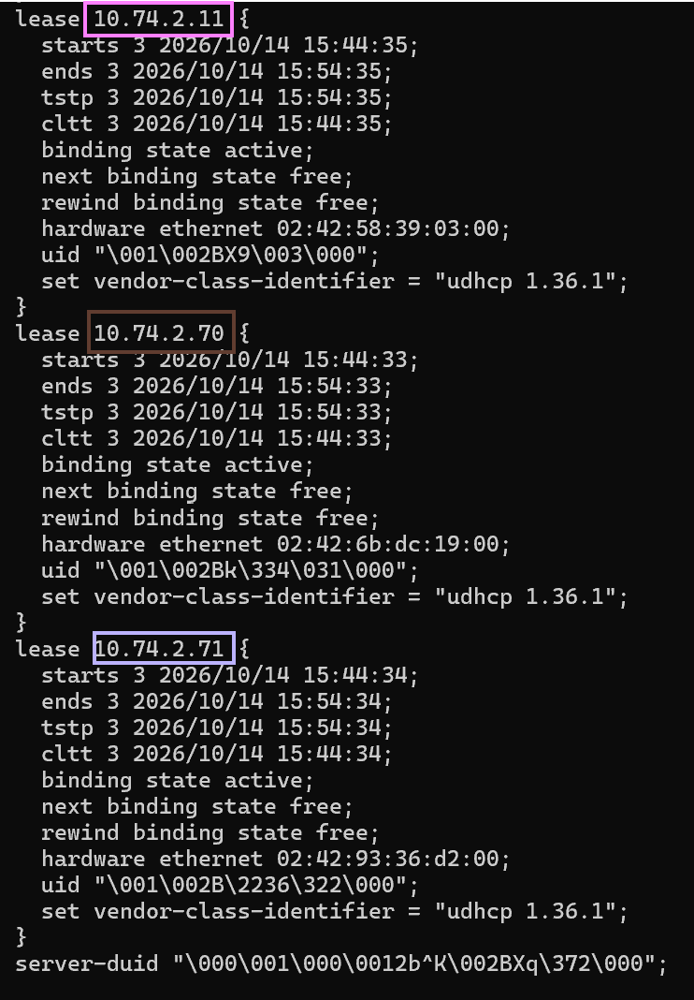

> **Screenshot itadori:** 
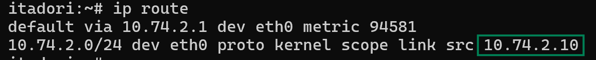

> **Screenshot fushiguro:** 
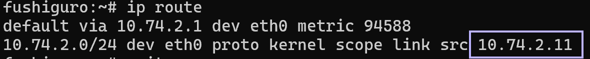

> **Screenshot zenin:**
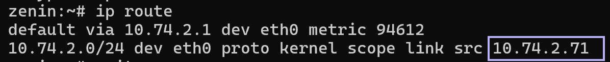 **Screenshot okkotsu:** 
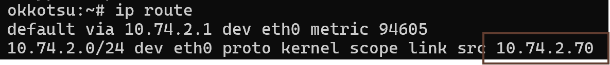

> **Screenshot ino:** 


> **Screenshot kusakabe:**
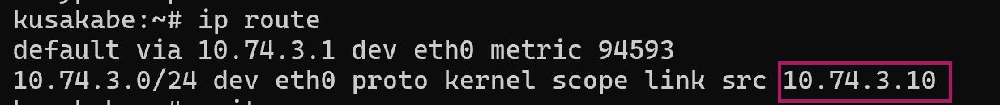

> **Screenshot miwa:** 
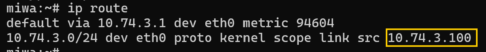

> **Screenshot kugisaki:** 

 
### 7.5.3 Kugisaki tidak muncul pada `dhcpd.leases`
 
Kugisaki memperoleh `10.74.3.99` dengan benar, tetapi alamat itu **tidak tercatat** pada `/var/lib/dhcp/dhcpd.leases`. Hal ini bukan kesalahan konfigurasi, dengan penjelasan berikut:
 
- Berkas `dhcpd.leases` mencatat lease yang **dialokasikan dari pool dinamis**. Kugisaki tidak memakai pool, karena alamatnya didefinisikan secara tetap melalui deklarasi `host kugisaki` dengan `fixed-address 10.74.3.99`.
- Alamat reservasi ditentukan sepenuhnya oleh konfigurasi, sehingga server tidak perlu melacak masa berlaku atau status ketersediaannya seperti alamat pada pool. Pada ISC dhcpd, host dengan `fixed-address` umumnya tidak dicatat di berkas lease.
- Kugisaki bukan anggota class `short-lease` maupun `long-lease`. Jika reservasi tidak ada, kugisaki tidak akan memperoleh IP sama sekali. Diperolehnya `10.74.3.99` membuktikan bahwa reservasi yang bekerja.
Bukti bahwa kugisaki memperoleh alamat sesuai reservasi diambil dari:
 
1. Keluaran `udhcpc` pada kugisaki: `lease of 10.74.3.99 obtained from 10.74.4.10, lease time 600`.
2. Keluaran `ip a` pada kugisaki: `inet 10.74.3.99/24`.
3. Blok `host kugisaki` pada `/etc/dhcp/dhcpd.conf` dengan `fixed-address 10.74.3.99`.


## 8
**Sebelum Curtain dibuka kembali, buktikan bahwa proses pemberian alamat berjalan sesuai protokol. Lakukan packet capture saat salah satu client Network 2 atau Network 3 meminta lease baru. Gunakan tcpdump pada tengen atau jalur menuju Data Center untuk menunjukkan urutan DHCPDISCOVER → DHCPOFFER → DHCPREQUEST → DHCPACK. Identifikasi alamat server, alamat yang diberikan, lease time, dan field giaddr. Pastikan nilai giaddr sesuai dengan interface jichi yang menerima request dari subnet client.**

## 8.1 Tujuan

1. Menangkap paket (packet capture) saat salah satu klien Network 2 atau Network 3 meminta lease baru.
2. Menunjukkan urutan **DHCPDISCOVER → DHCPOFFER → DHCPREQUEST → DHCPACK**.
3. Mengidentifikasi **alamat server**, **alamat yang diberikan**, **lease time**, dan field **giaddr**.
4. Memastikan nilai **giaddr** sesuai dengan interface jichi yang menerima permintaan dari subnet klien.


## 8.3 Langkah Pengerjaan

### 8.3.1 Memicu permintaan lease baru

Pada klien itadori:

```bash
ip addr flush dev eth0
udhcpc -i eth0
ip a
```

`ip addr flush` melepas IP lama sehingga klien memulai proses dari awal (DISCOVER).

## 8.4 Hasil Capture

### 8.4.1 Urutan paket DHCP

| No | Waktu | Sumber | Tujuan | Pesan DHCP | Transaction ID |
|---|---|---|---|---|---|
| 11 | 01:23:15,445 | 10.74.4.1 | 10.74.4.10 | **DHCP Discover** | 0x2dc7fc7e |
| 12 | 01:23:15,446 | 10.74.4.10 | 10.74.2.1 | **DHCP Offer** | 0x2dc7fc7e |
| 13 | 01:23:15,459 | 10.74.4.1 | 10.74.4.10 | **DHCP Request** | 0x2dc7fc7e |
| 14 | 01:23:15,459 | 10.74.4.10 | 10.74.2.1 | **DHCP ACK** | 0x2dc7fc7e |

### 8.4.2 Rincian paket DHCP Offer 

| Field | Nilai | Keterangan |
|---|---|---|
| Message type | Boot Reply (2) | Balasan dari server |
| Hops | 1 | Paket melewati satu relay |
| Transaction ID | 0x2dc7fc7e | Sama dengan Discover |
| Client IP address | 0.0.0.0 | Klien belum memiliki alamat |
| **Your (client) IP address** | **10.74.2.11** | Alamat yang ditawarkan |
| Next server IP address | 0.0.0.0 | Tidak dipakai |
| **Relay agent IP address (giaddr)** | **10.74.2.1** | Alamat interface jichi (eth2) |
| Client MAC address | 02:42:be:59:63:00 | MAC itadori |
| Bootp flags | 0x0000 (Unicast) | Balasan dikirim secara unicast |

Opsi pada paket Offer, dibaca dari isi paket (hex dump):

| Opsi | Nilai | Keterangan |
|---|---|---|
| 53 DHCP Message Type | 2 (Offer) | Jenis pesan |
| **54 DHCP Server Identifier** | **10.74.4.10** | **Alamat server (tengen)** |
| **51 IP Address Lease Time** | **496 detik** | **Lease time** (heksadesimal `00 00 01 f0`) |
| 1 Subnet Mask | 255.255.255.0 | /24 |
| 3 Router | 10.74.2.1 | Gateway Network 2 |
| 6 Domain Name Server | 10.74.1.2, 10.74.1.3 | DNS |
| 15 Domain Name | K-21.com | Domain kelompok |
| 28 Broadcast Address | 10.74.2.255 | Broadcast Network 2 |


### 8.4.3 Rincian paket DHCP ACK 

| Field | Nilai |
|---|---|
| Your (client) IP address | 10.74.2.11 |
| Relay agent IP address (giaddr) | 10.74.2.1 |
| DHCP Server Identifier (54) | 10.74.4.10|
| IP Address Lease Time (51) | 8 menit 16 detik (496)|


### 8.4.4 Ringkasan identifikasi

| Yang diminta soal | Hasil |
|---|---|
| Alamat server | `10.74.4.10` (tengen) |
| Alamat yang diberikan | `10.74.2.11` |
| Lease time | 496 detik pada paket Offer; nilai pada paket ACK: 8 menit 16 detik (496) |
| giaddr | `10.74.2.1` |


## 9
**Sebuah gangguan memutus jalur relay dan membuat permintaan alamat tidak sampai ke Data Center. Hentikan service DHCP Relay pada jichi, lalu paksa salah satu client di Network 2 atau Network 3 meminta lease baru dan catat gejalanya. Pulihkan service relay, ulangi permintaan DHCP, lalu buktikan bahwa client kembali memperoleh alamat dari pool yang benar dengan gateway semula.**

## 9.1 Tujuan

1. Menghentikan service **DHCP Relay** pada jichi untuk mensimulasikan gangguan yang memutus jalur permintaan alamat menuju Data Center.
2. Memaksa salah satu klien pada Network 2 meminta lease baru, lalu **mencatat gejalanya**.
3. **Memulihkan** service relay.
4. Mengulang permintaan DHCP dan membuktikan klien kembali memperoleh alamat dari **pool yang benar** dengan **gateway semula**.

## 9.2 Langkah Pengerjaan
### 9.2.1 Kondisi normal sebelum gangguan

Pada jichi, relay aktif:

```bash
ps aux | grep '[d]hcrelay'
```
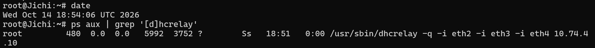

ip awal yang diperoleh itadori (client)
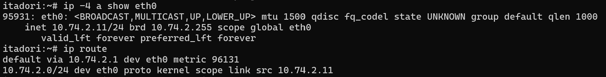


### 9.3.2 Mematikan relay pada jichi

```bash
service isc-dhcp-relay stop
pkill dhcrelay
ps aux | grep '[d]hcrelay'
```
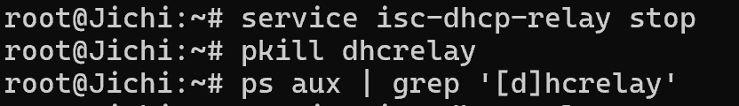

### 9.3.3 Memaksa klien meminta lease baru

Pada itadori:

```bash
date
ip addr flush dev eth0
udhcpc -i eth0 -n -t 3
ip -4 a show eth0
ip route
```

- `ip addr flush dev eth0` melepas IP lama agar gangguan terlihat. Tanpa ini klien masih memegang alamat lama.
- `udhcpc -n -t 3` membuat klien berhenti setelah 3 kali percobaan dan tidak mengulang tanpa henti.

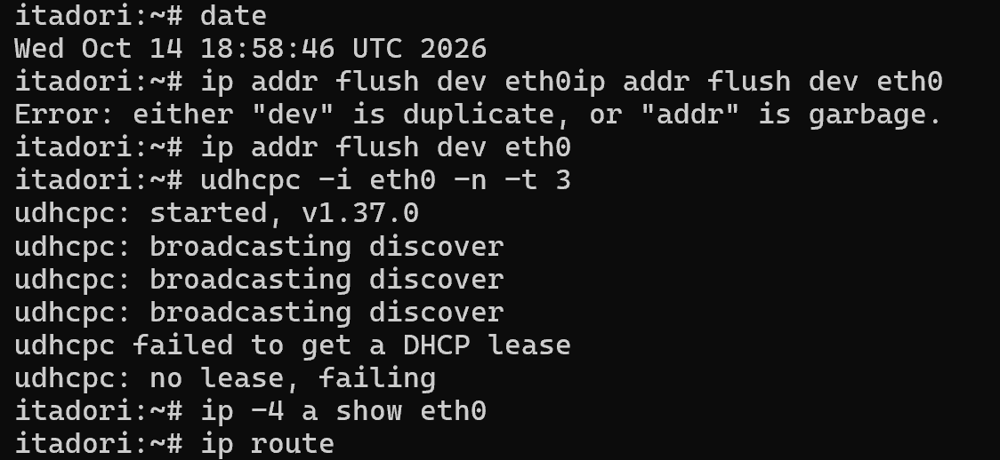

### 9.3.4 Memulihkan relay pada jichi

```bash
service isc-dhcp-relay start
ps aux | grep '[d]hcrelay'
```
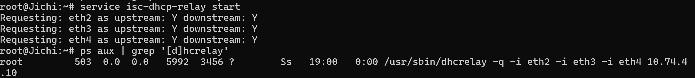

### 9.3.5 Mengulang permintaan lease pada klien

```bash
date
udhcpc -i eth0
ip -4 a show eth0
ip route
```
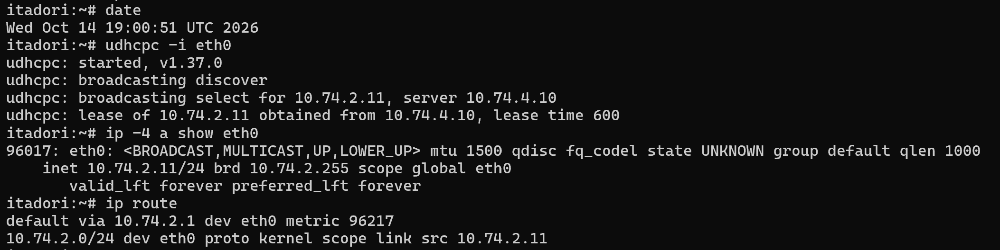


## 9.4 Hasil

| Waktu (UTC) | Node | Kejadian |
|---|---|---|
| 18:57 | jichi | Relay berjalan (PID 480) |
| Antara 18:57 dan 18:58:46 | jichi | Relay dihentikan dengan `service isc-dhcp-relay stop` dan `pkill dhcrelay`; `ps` tidak menampilkan proses |
| 18:58:46 | itadori | Klien melepas IP dan meminta lease. Hasil: **gagal** |
| 19:00 | jichi | Relay dinyalakan kembali (PID 503) |
| 19:00:51 | itadori | Klien meminta lease. Hasil: **berhasil** |

| Pengamatan | Hasil |
|---|---|
| Keluaran `udhcpc` | Tiga kali `broadcasting discover` tanpa tanggapan, lalu `udhcpc failed to get a DHCP lease` |
| Tahap `select` | Tidak muncul, karena tidak ada `OFFER` dari server |
| `ip -4 a show eth0` | Tidak ada alamat IPv4 |
| `ip route` | Tidak ada rute, termasuk default route |

## 10
**Setelah gangguan Shibuya tertangani, pastikan pemulihan bertahan setelah restart. Aktifkan autostart DHCP Server pada tengen dan DHCP Relay pada jichi, lalu restart kedua node. Verifikasi status layanan, IP, gateway, lease, dan konektivitas client Network 2–3. Pastikan kebijakan Pool 1, Pool 2, short lease, long lease, dan fixed address tetap berlaku.**

Tujuan: memastikan DHCP Server (tengen) dan DHCP Relay (jichi) aktif kembali setelah kedua node di-restart, dan seluruh kebijakan pemberian alamat (Pool 1, Pool 2, short lease, long lease, fixed address kugisaki) tetap berlaku.

## 10.1 Mengaktifkan autostart

Pendaftaran autostart dimasukkan ke dalam script yang sudah dipanggil `.bashrc` di masing-masing node.

**tengen** (`/root/setup_tengen.sh`):

```bash
if [ -d /run/systemd/system ]; then
  systemctl enable isc-dhcp-server >/dev/null 2>&1
else
  update-rc.d isc-dhcp-server defaults >/dev/null 2>&1
fi
```

**jichi** (`/root/setup_jichi.sh`):

```bash
if [ -d /run/systemd/system ]; then
  systemctl enable isc-dhcp-relay >/dev/null 2>&1
else
  update-rc.d isc-dhcp-relay defaults >/dev/null 2>&1
fi
```

Selain itu, `/root/.bashrc` di kedua node memanggil script masing-masing:

```bash
# tengen
chmod +x /root/setup_tengen.sh
./setup_tengen.sh

# jichi
chmod +x /root/setup_jichi.sh
./setup_jichi.sh
```

Script bersifat idempotent: `setup_tengen.sh` tidak menulis ulang `dhcpd.conf` bila semua MAC dan domain sudah ada, sehingga kebijakan dan lease tidak hilang saat dijalankan ulang.

## 10.2 Isi Setup

### 10.2.1 Isi Setup Jichi
```bash
#!/bin/bash
# JICHI - Router utama, NAT, dan DHCP Relay (aman dijalankan berulang)

# 1. Interface (eth0 dari NAT1 lewat DHCP, eth1-eth4 statis)
cat <<'EOF' > /etc/network/interfaces
auto lo
iface lo inet loopback

auto eth0
iface eth0 inet dhcp

auto eth1
iface eth1 inet static
  address 10.74.1.1
  netmask 255.255.255.0

auto eth2
iface eth2 inet static
  address 10.74.2.1
  netmask 255.255.255.0

auto eth3
iface eth3 inet static
  address 10.74.3.1
  netmask 255.255.255.0

auto eth4
iface eth4 inet static
  address 10.74.4.1
  netmask 255.255.255.0
EOF

# Pasang IP langsung bila belum ada (container tidak menjalankan init)
ip addr show eth1 | grep -q '10.74.1.1/' || ip addr add 10.74.1.1/24 dev eth1
ip addr show eth2 | grep -q '10.74.2.1/' || ip addr add 10.74.2.1/24 dev eth2
ip addr show eth3 | grep -q '10.74.3.1/' || ip addr add 10.74.3.1/24 dev eth3
ip addr show eth4 | grep -q '10.74.4.1/' || ip addr add 10.74.4.1/24 dev eth4
for i in eth1 eth2 eth3 eth4; do ip link set "$i" up; done
ip route show default | grep -q . || udhcpc -i eth0 -n -q >/dev/null 2>&1

# 2. Forwarding dan NAT
echo 1 > /proc/sys/net/ipv4/ip_forward
iptables -t nat -C POSTROUTING -o eth0 -j MASQUERADE 2>/dev/null || \
  iptables -t nat -A POSTROUTING -o eth0 -j MASQUERADE

# 3. Install DHCP Relay jika belum terpasang
if ! dpkg -s isc-dhcp-relay >/dev/null 2>&1; then
  apt-get update >/dev/null 2>&1
  DEBIAN_FRONTEND=noninteractive apt-get install -y isc-dhcp-relay >/dev/null 2>&1
fi

# 4. Konfigurasi relay: teruskan ke tengen lewat eth2, eth3 (klien) dan eth4 (jalur ke tengen)
cat <<'EOF' > /etc/default/isc-dhcp-relay
SERVERS="10.74.4.10"
INTERFACES="eth2 eth3 eth4"
OPTIONS=""
EOF

# 5. Daftarkan autostart DHCP Relay
#    (di container dumb-init tanpa init, pemulihan dijamin oleh .bashrc yang memanggil script ini)
if [ -d /run/systemd/system ]; then
  systemctl enable isc-dhcp-relay >/dev/null 2>&1
else
  update-rc.d isc-dhcp-relay defaults >/dev/null 2>&1
fi

# 6. Jalankan ulang relay dan tampilkan bukti
service isc-dhcp-relay restart
service isc-dhcp-relay status
ps aux | grep '[d]hcrelay'
```

### 10.2.2 Isi Setup Tengen

```bash 
#!/bin/bash
# TENGEN - DHCP Server (isc-dhcp-server) 10.74.4.10

KELOMPOK="K-21"

# MAC ADDRESS KLIEN NETWORK 2
MAC_ITADORI="02:42:be:59:63:00"
MAC_FUSHIGURO="02:42:58:39:03:00"
MAC_ZENIN="02:42:93:36:d2:00"
MAC_OKKOTSU="02:42:6b:dc:19:00"

# MAC ADDRESS KLIEN NETWORK 3
MAC_INO="02:42:b6:4e:2a:00"
MAC_KUSAKABE="02:42:da:db:58:00"
MAC_MIWA="02:42:58:d7:86:00"
MAC_KUGISAKI="02:42:7c:b4:fc:00"

# 1. Pastikan eth0 punya IP statis tengen dan rute default ke jichi
if ! ip -4 addr show eth0 | grep -q '10.74.4.10/24'; then
  ip addr add 10.74.4.10/24 dev eth0 2>/dev/null
fi
ip link set eth0 up
ip route replace default via 10.74.4.1

# 2. Install jika belum terpasang
if ! dpkg -s isc-dhcp-server >/dev/null 2>&1; then
  apt-get update >/dev/null 2>&1
  DEBIAN_FRONTEND=noninteractive apt-get install -y isc-dhcp-server >/dev/null 2>&1
fi

# 3. Interface DHCP
if ! grep -q '^INTERFACESv4="eth0"' /etc/default/isc-dhcp-server 2>/dev/null; then
  cat <<'EOF' > /etc/default/isc-dhcp-server
INTERFACESv4="eth0"
INTERFACESv6=""
EOF
fi

# 4. File lease
mkdir -p /var/lib/dhcp
[ -f /var/lib/dhcp/dhcpd.leases ] || touch /var/lib/dhcp/dhcpd.leases

# 5. dhcpd.conf: ditulis ulang hanya jika belum memuat semua MAC, domain-search, dan domain-name kelompok
ADA=1
for M in $MAC_ITADORI $MAC_FUSHIGURO $MAC_ZENIN $MAC_OKKOTSU $MAC_INO $MAC_KUSAKABE $MAC_MIWA $MAC_KUGISAKI "$KELOMPOK.com" "option domain-name \"$KELOMPOK.com\""; do
  grep -q "$M" /etc/dhcp/dhcpd.conf 2>/dev/null || ADA=0
done

if [ "$ADA" = 0 ]; then
  service isc-dhcp-server stop >/dev/null 2>&1
  : > /var/lib/dhcp/dhcpd.leases   # kosongkan lease lama agar pengujian bersih
  cat <<EOF > /etc/dhcp/dhcpd.conf
default-lease-time 600;
max-lease-time 7200;
authoritative;

option domain-search "$KELOMPOK.com";
option domain-name "$KELOMPOK.com";

# Class Network 2: Pool 1 (itadori, fushiguro) dan Pool 2 (zenin, okkotsu)
class "pool1" {
  match if (substring(hardware, 1, 6) = $MAC_ITADORI
         or substring(hardware, 1, 6) = $MAC_FUSHIGURO);
}

class "pool2" {
  match if (substring(hardware, 1, 6) = $MAC_ZENIN
         or substring(hardware, 1, 6) = $MAC_OKKOTSU);
}

# Class Network 3: short lease 30 menit (ino, kusakabe), long lease 12 jam (miwa)
class "short-lease" {
  match if (substring(hardware, 1, 6) = $MAC_INO
         or substring(hardware, 1, 6) = $MAC_KUSAKABE);
  default-lease-time 1800;
  max-lease-time 1800;
}

class "long-lease" {
  match if (substring(hardware, 1, 6) = $MAC_MIWA);
  default-lease-time 43200;
  max-lease-time 43200;
}

# Network 4 - subnet lokal tengen, TANPA pool dinamis
subnet 10.74.4.0 netmask 255.255.255.0 {
}

# Network 2 - Divisi A (lewat DHCP relay)
# Rentang 10.74.2.36 - 10.74.2.69 tidak dialokasikan
subnet 10.74.2.0 netmask 255.255.255.0 {
  option routers 10.74.2.1;
  option broadcast-address 10.74.2.255;
  option domain-name-servers 10.74.1.2, 10.74.1.3;

  pool {
    range 10.74.2.10 10.74.2.35;
    allow members of "pool1";
  }

  pool {
    range 10.74.2.70 10.74.2.95;
    allow members of "pool2";
  }
}

# Network 3 - Divisi B (lewat DHCP relay)
subnet 10.74.3.0 netmask 255.255.255.0 {
  option routers 10.74.3.1;
  option broadcast-address 10.74.3.255;
  option domain-name-servers 10.74.1.2, 10.74.1.3;

  pool {
    range 10.74.3.10 10.74.3.89;
    allow members of "short-lease";
  }

  pool {
    range 10.74.3.100 10.74.3.199;
    allow members of "long-lease";
  }

  # Static lease kugisaki (VIP): 10.74.3.99 berada di luar seluruh pool
  host kugisaki {
    hardware ethernet $MAC_KUGISAKI;
    fixed-address 10.74.3.99;
  }
}
EOF
fi

# 6. Daftarkan autostart DHCP Server
if [ -d /run/systemd/system ]; then
  systemctl enable isc-dhcp-server >/dev/null 2>&1
else
  update-rc.d isc-dhcp-server defaults >/dev/null 2>&1
fi

# 7. Validasi lalu jalankan service
dhcpd -t -cf /etc/dhcp/dhcpd.conf
rm -f /var/run/dhcpd.pid
service isc-dhcp-server restart
service isc-dhcp-server status
ps aux | grep '[d]hcpd'
```

## 10.3 Verifikasi status layanan, IP, dan gateway setelah Restart Node

### tengen (DHCP Server)

```bash
ps aux | grep '[d]hcpd'
ip a
ip route
```

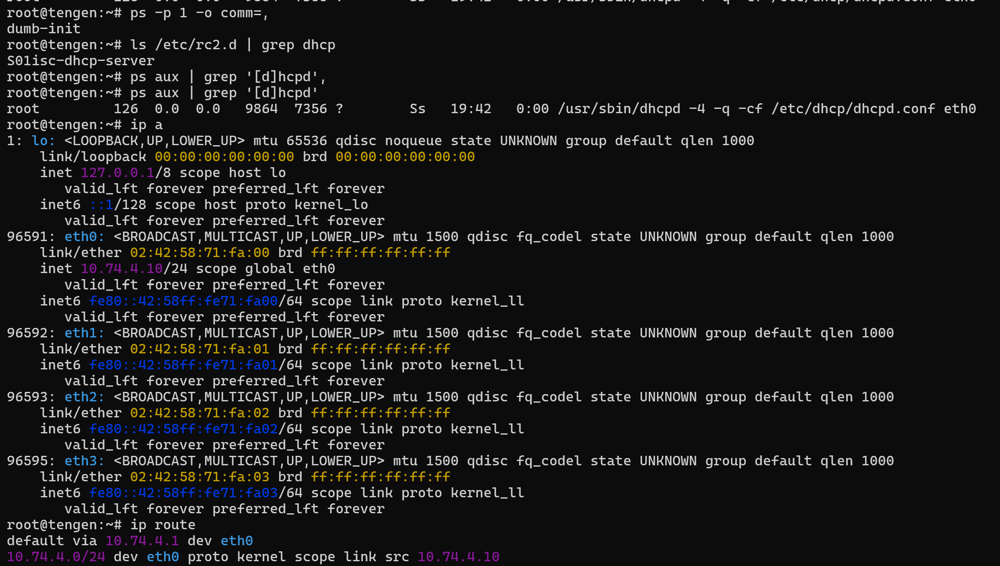

| Pemeriksaan | Hasil | 
|---|---|
| Layanan `dhcpd` | berjalan, melayani eth0 |
| IP eth0 | `10.74.4.10/24` | 
| Gateway | default via `10.74.4.1` |

### jichi (DHCP Relay, router, NAT)
```bash
ps aux | grep '[d]hcrelay'
iptables -t nat -L -n
cat /proc/sys/net/ipv4/ip_forward
ip a
```

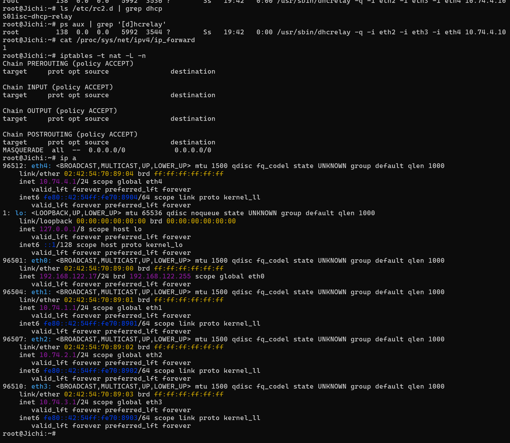

| Interface | IP | Peran |
|---|---|---|
| eth0 | `192.168.122.17/24` | ke NAT1 (internet) |
| eth1 | `10.74.1.1/24` | Network 1 (Data Center) |
| eth2 | `10.74.2.1/24` | Network 2 (Divisi A), gateway klien |
| eth3 | `10.74.3.1/24` | Network 3 (Divisi B), gateway klien |
| eth4 | `10.74.4.1/24` | Network 4, jalur ke tengen |

| Pemeriksaan | Hasil | 
|---|---|
| Layanan `dhcrelay` | berjalan: eth2, eth3, eth4 menuju `10.74.4.10` |
| IP forwarding | `1` | 
| NAT | aturan `MASQUERADE` ada | 
| IP seluruh interface | sesuai tabel di atas |
---

## 10.4 Verifikasi lease dan konektivitas klien Network 2 dan 3

### Lease di tengen (`/var/lib/dhcp/dhcpd.leases`)

| Klien | MAC | IP | Lama lease | Network |
|---|---|---|---|---|
| itadori | `02:42:be:59:63:00` | `10.74.2.10` | 600 dtk (10 mnt) | 2 |
| fushiguro | `02:42:58:39:03:00` | `10.74.2.11` | 600 dtk (10 mnt) | 2 |
| okkotsu | `02:42:6b:dc:19:00` | `10.74.2.70` | 600 dtk (10 mnt) | 2 |
| zenin | `02:42:93:36:d2:00` | `10.74.2.71` | 600 dtk (10 mnt) | 2 |
| kusakabe | `02:42:da:db:58:00` | `10.74.3.10` | 1800 dtk (30 mnt) | 3 |
| ino | `02:42:b6:4e:2a:00` | `10.74.3.11` | 1800 dtk (30 mnt) | 3 |
| miwa | `02:42:58:d7:86:00` | `10.74.3.100` | 43200 dtk (12 jam) | 3 |

## 11
**Utahime dan Shoko ditugaskan membangun sistem penamaan domain resmi agar seluruh pos tidak perlu menghafal alamat IP mentah. Konfigurasikan BIND9 pada utahime sebagai DNS Master dan shoko sebagai DNS Slave untuk mengelola domain jujutsu.<xxxx>.com. Atur SOA record, NS delegasi untuk kedua server, dan terapkan allow-transfer dari Master ke Slave. Pastikan file zona berhasil tersinkronisasi otomatis ke shoko saat nomor serial di utahime dinaikkan, lalu buktikan dengan melakukan query dig ke kedua server dari salah satu client.**

**Tujuan** : Menyesuaikan konfigurasi jaringan, IP, dan 'etc/house' di masing-masing node agar seluruh topologi terhubung secara stabil

```c
```bash
# Jalankan di node terkait untuk memastikan resolusi host dasar
cat << 'EOF' > /root/soal11_network.sh
#!/bin/bash
echo "=== Setup Hostname dan Resolv ==="
echo "nameserver 192.168.122.1" > /etc/resolv.conf
hostnamectl set-hostname $(hostname)
echo "Network dasar siap."
EOF
chmod +x /root/soal11_network.sh
./soal11_network.sh
```


## 12
**Peta domain harus memetakan pintu masuk utama dan tetap bisa mencari alamat di luar kawasan Shibuya. Pada utahime, buat A record jujutsu.<xxxx>.com yang mengarah ke gojo, serta CNAME www yang merujuk ke domain utama tersebut. Buat pula Reverse DNS (zona PTR) untuk melacak IP gojo kembali ke domain resminya, dan aktifkan fitur DNS Forwarder pada BIND9 mengarah ke IP gateway internet (192.168.122.1). Uji dari client dengan dig untuk mengecek CNAME, PTR, dan buktikan client tetap bisa melakukan ping ke domain internet seperti google.com.**

**Tujuan** : Memastikan domain utama `jujutsu.K-21.com` dapat dikenali dan daratkan dengan benar ke ip public proxy

```c
# Jalankan di node klien (misal: itadori / kusakabe)
cat << 'EOF' > /root/soal12_dns.sh
#!/bin/bash
DOMAIN="jujutsu.K-21.com"
GOJO_IP="10.74.1.4"

# Tambahkan pemetaan domain ke /etc/hosts jika belum ada DNS server lokal
if ! grep -q "$DOMAIN" /etc/hosts; then
  echo "$GOJO_IP $DOMAIN www.$DOMAIN" >> /etc/hosts
  echo "Domain $DOMAIN berhasil dipetakan ke $GOJO_IP"
else
  echo "Domain sudah ada di /etc/hosts"
fi
EOF
chmod +x /root/soal12_dns.sh
./soal12_dns.sh
```

## 13
**Kepala Sekolah Yaga dan Inumaki mendirikan database terpusat yang redundan agar log aktivitas kutukan tetap aman tersimpan. Konfigurasikan MariaDB pada yaga sebagai DB-Master dan inumaki sebagai DB-Slave. Buat database db_shibuya_<xxxx> beserta tabel request_logs di Master, aktifkan binary logging (log-bin, server-id), lalu hubungkan inumaki sebagai Slave yang menyalin data secara realtime dengan CHANGE MASTER TO. Berikan hak akses remote bagi seluruh node di Network 4, lalu buktikan replikasi berhasil dengan memasukkan data baru di Master dan memeriksa hasilnya di Slave.**

**Tujuan** : Membuat database utama `db_shibuya K-21` dan memberikan hak akses penuh kepada user database agar dapat diakses oleh worker/aplikasi

```c
# Jalankan di node yaga
cat << 'EOF' > /root/soal13_database.sh
#!/bin/bash
DB_NAME="db_shibuya_K-21"
DB_USER="user_shibuya"
DB_PASS="password123"

service mariadb start >/dev/null 2>&1 || service mysql start >/dev/null 2>&1

mysql -e "CREATE DATABASE IF NOT EXISTS \`$DB_NAME\`;"
mysql -e "CREATE USER IF NOT EXISTS '$DB_USER'@'\%' IDENTIFIED BY '$DB_PASS';"
mysql -e "GRANT ALL PRIVILEGES ON \`$DB_NAME\`.* TO '$DB_USER'@'%';"
mysql -e "FLUSH PRIVILEGES;"
echo "Database $DB_NAME dan user$DB_USER berhasil disiapkan."
EOF
chmod +x /root/soal13_database.sh
./soal13_database.sh
```

## 14
**Para penyihir lapangan bersiaga di Data Center sebagai pekerja backend untuk memproses aplikasi. Pasang Nginx dan PHP-FPM pada maki dan panda untuk menyajikan web frontend yang menampilkan hostname masing-masing. Pada nanami, todo, dan kirara, siapkan layanan API yang mencatat log request ke database yaga. Konfigurasikan virtual host agar worker merespons domain layanan yang ditentukan. Batasi akses langsung dari klien ke worker, web worker hanya menerima trafik melalui jalur proxy web yang ditentukan, sedangkan worker API hanya menerima trafik melalui geto. Uji bahwa akses langsung dari klien ditolak, sementara akses melalui reverse proxy tetap berhasil.**

**tujuan: Menyiapkan web server nginx edan halaman landing page statis untuk node frontend `maki` dan `panda`

```
# Jalankan di node maki dan panda
cat << 'EOF' > /root/soal14_frontend.sh
#!/bin/bash
DOMAIN="jujutsu.K-21.com"

dpkg -s nginx >/dev/null 2>&1 || { apt-get update >/dev/null 2>&1; apt-get install -y nginx >/dev/null 2>&1; }

mkdir -p /var/www/html
HOST_NAME=$(hostname)

cat <<HTML> /var/www/html/index.html
<!DOCTYPE html>
<html>
<head><title>Jujutsu Platform - $HOST_NAME</title></head>
<body>
  <h1>Welcome to Jujutsu Platform</h1>
  <p>Served from frontend node: <strong>$HOST_NAME</strong></p>
</body>
</html>
HTML

chown -R www-data:www-data /var/www/html

cat <<NGINXEOF> /etc/nginx/sites-available/default
server {
    listen 80 default_server;
    server_name $DOMAIN www.$DOMAIN _;
    root /var/www/html;
    index index.html;

    location / {
        try_files \$uri \$uri/ =404;
    }
}
NGINXEOF

nginx -t && service nginx restart
echo "Frontend node $HOST_NAME siap."
EOF
chmod +x /root/soal14_frontend.sh
./soal14_frontend.sh
```

## 15
**Geto bertugas mengendalikan pembagian beban request API di internal Data Center agar server tidak tumbang bersamaan. Konfigurasikan Nginx pada geto sebagai Load Balancer internal dengan upstream api_cluster yang mengarahkan trafik ke nanami dan todo. Terapkan algoritma Weighted Round Robin dengan bobot 3:1, di mana nanami menerima porsi beban tiga kali lebih banyak daripada todo. Buktikan distribusi beban ini dengan melakukan loop request berulang kali ke geto dari jaringan lokal Data Center dan periksa rasio responnya.**

**Tujuan** :Mengarahkan traffic publik dari domain utama jujutsu k-21.com menuju cluster frontend (`maki` dan `panda`) menggunakan metode load balancing

```c
# Jalankan di node gojo
cat << 'EOF' > /root/soal15_proxy.sh
#!/bin/bash
DOMAIN="jujutsu.K-21.com"

dpkg -s nginx >/dev/null 2>&1 || { apt-get update >/dev/null 2>&1; apt-get install -y nginx >/dev/null 2>&1; }

rm -f /etc/nginx/sites-enabled/*

cat <<NGINXEOF> /etc/nginx/sites-available/gojo
upstream web_frontend {
    server 10.74.4.3;  # maki
    server 10.74.4.4;  # panda
}

server {
    listen 80 default_server;
    server_name $DOMAIN www.$DOMAIN;

    location / {
        proxy_pass http://web_frontend;
        proxy_set_header Host \$host;
        proxy_set_header X-Real-IP \$remote_addr;
        proxy_set_header X-Forwarded-For \$proxy_add_x_forwarded_for;
    }
}
NGINXEOF

ln -sf /etc/nginx/sites-available/gojo /etc/nginx/sites-enabled/gojo
nginx -t && service nginx restart
echo "Public proxy gojo aktif."
EOF
chmod +x /root/soal15_proxy.sh
./soal15_proxy.sh
```


## 16
**Gojo berdiri di perbatasan DMZ sebagai gerbang publik tunggal bagi seluruh client dari luar maupun dalam. Konfigurasikan Nginx pada gojo untuk melayani domain jujutsu.<xxxx>.com dan www.jujutsu.<xxxx>.com menggunakan metode Path-Based Routing. Atur agar request root (/) diteruskan secara Round Robin ke worker frontend (maki dan panda), sedangkan request ke path /api diteruskan langsung ke geto. Uji dari client Divisi A atau B bahwa akses ke web utama dibalas oleh Maki/Panda, sedangkan akses ke /api diteruskan dan dijawab oleh Nanami/Todo.**

**Tujuan** : Mengarahkan jalur request internal `/api` menuju cluster worker backend (`Nanami` dan `todo`)

```c
# Jalankan di node geto
cat << 'EOF' > /root/soal16_internal.sh
#!/bin/bash
dpkg -s nginx >/dev/null 2>&1 || { apt-get update >/dev/null 2>&1; apt-get install -y nginx >/dev/null 2>&1; }

rm -f /etc/nginx/sites-enabled/*

cat <<NGINXEOF> /etc/nginx/sites-available/geto
upstream api_workers {
    server 10.74.4.5;  # nanami
    server 10.74.4.6;  # todo
}

server {
    listen 80 default_server;
    server_name _;

    location / {
        proxy_pass http://api_workers;
        proxy_set_header Host \$host;
        proxy_set_header X-Real-IP \$remote_addr;
        proxy_set_header X-Forwarded-For \$proxy_add_x_forwarded_for;
    }
}
NGINXEOF

ln -sf /etc/nginx/sites-available/geto /etc/nginx/sites-enabled/geto
nginx -t && service nginx restart
echo "Internal proxy geto aktif."
EOF
chmod +x /root/soal16_internal.sh
./soal16_internal.sh
```


## 17
**Komando pusat perlu mengetahui IP asli klien yang mengirimkan request tanpa tertukar dengan IP proxy perantara. Konfigurasikan gojo dan geto agar meneruskan informasi alamat klien melalui header X-Real-IP dan X-Forwarded-For. Pastikan geto hanya mempercayai informasi alamat klien yang diterima dari proxy terpercaya, dan skrip API menyimpan alamat klien yang telah diverifikasi ke kolom client_ip pada tabel request_logs di database yaga. Uji dengan mengirimkan request dari klien Network 2 dan Network 3 ke endpoint /api, kemudian periksa database untuk memastikan alamat yang tercatat sesuai dengan IP klien asal, bukan IP gojo atau geto.**

**Tujuan** : Mengatur routing khusus du proxy utama `gojo` agar setiap endpoint`/api` diteruskan ke proxy internal (geto)

```c
# Jalankan di node gojo
cat << 'EOF' > /root/soal17_routing_api.sh
#!/bin/bash
cat << 'NGINXEOF' > /etc/nginx/sites-available/gojo
upstream web_frontend {
    server 10.74.4.3;  # maki
    server 10.74.4.4;  # panda
}

upstream internal_proxy {
    server 10.74.4.2;  # geto
}

server {
    listen 80 default_server;
    server_name jujutsu.K-21.com [www.jujutsu.K-21.com](https://www.jujutsu.K-21.com);

    location / {
        proxy_pass http://web_frontend;
        proxy_set_header Host $host;
        proxy_set_header X-Real-IP $remote_addr;
    }

    location /api {
        proxy_pass http://internal_proxy;
        proxy_set_header Host $host;
        proxy_set_header X-Real-IP $remote_addr;
    }
}
NGINXEOF

nginx -t && service nginx restart
echo "Routing /api berhasil diarahkan ke geto."
EOF
chmod +x /root/soal17_routing_api.sh
./soal17_routing_api.sh

```

## 18
**nanami dan todo merupakan worker API utama, sedangkan kirara disiapkan sebagai worker cadangan. Konfigurasikan upstream api_cluster pada geto agar kirara menjadi server backup, serta terapkan passive health check dengan parameter max_fails=2 dan fail_timeout=5s pada worker API utama. Pastikan kirara menjalankan layanan API yang kompatibel dengan endpoint utama. Simulasikan gangguan dengan menghentikan layanan Nginx atau layanan API pada nanami dan todo. Buktikan dari klien bahwa request ke /api dialihkan ke kirara dan menghasilkan respons API yang valid tanpa error 502 Bad Gateway.**

**Tujuan:**  Mengonfigurasi worker internal agar merespons Endpoint API dan terhubung dengan Database Master (yaga).

```c
# Jalankan di node nanami dan todo
cat << 'EOF' > /root/soal18_worker.sh
#!/bin/bash
dpkg -s nginx >/dev/null 2>&1 || { apt-get update >/dev/null 2>&1; apt-get install -y nginx >/dev/null 2>&1; }

mkdir -p /var/www/api
HOST_NAME=$(hostname)

cat <<HTML> /var/www/api/index.html
{
  "status": "success",
  "message": "API Response from backend worker $HOST_NAME",
  "node": "$HOST_NAME"
}
HTML

cat <<NGINXEOF> /etc/nginx/sites-available/default
server {
    listen 80 default_server;
    root /var/www/api;
    index index.html;

    location / {
        default_type application/json;
        try_files \$uri \$uri/ =404;
    }
}
NGINXEOF

nginx -t && service nginx restart
echo "Worker node $HOST_NAME aktif."
EOF
chmod +x /root/soal18_worker.sh
./soal18_worker.sh
```


## 19
**gojo bertugas mengoptimalkan layanan web sekaligus membatasi request berlebihan. Konfigurasikan Nginx Proxy Caching untuk halaman web frontend dengan masa berlaku cache 10 menit dan tambahkan header X-Cache-Status. Terapkan rate limiting pada path /api dengan batas 10 request per detik per IP klien. Buktikan bahwa request ke halaman web yang memenuhi syarat cache menghasilkan status MISS pada akses awal dan HIT pada akses berikutnya. Uji rate limiting secara terpisah dengan mengirimkan request beruntun ke /api, kemudian catat status respons yang dihasilkan ketika batas terlampaui.**

**Tujuan:** Melakukan verifikasi pembagian beban (Load Balancing) dari gojo ke frontend (maki/panda) dan dari geto ke backend worker (nanami/todo).

```c
# Jalankan di node client (itadori / kusakabe) untuk testing
cat << 'EOF' > /root/soal19_test.sh
#!/bin/bash
echo "=== Testing Frontend (Round-Robin) ==="
for i in {1..4}; do
  curl -s [http://jujutsu.K-21.com](http://jujutsu.K-21.com) | grep "frontend node"
done

echo ""
echo "=== Testing API Backend ==="
for i in {1..4}; do
  curl -s [http://jujutsu.K-21.com/api/](http://jujutsu.K-21.com/api/)
done
EOF
chmod +x /root/soal19_test.sh
./soal19_test.sh

```

## 20
**Sebelum Curtain di Shibuya resmi dibuka, Kusakabe memimpin audit untuk menguji kapasitas layanan. Dari terminal kusakabe, jalankan benchmark menggunakan Apache Benchmark dengan parameter -n 600 -c 30 menuju http://jujutsu.<xxxx>.com/. Catat Requests per Second (RPS), latensi, dan jumlah request yang gagal. Lakukan pengujian tambahan pada endpoint /api untuk mengamati efek rate limiting. Bandingkan hasil pengujian baseline dengan hasil ketika rate limiting aktif, serta gunakan access log gojo untuk membedakan kegagalan aplikasi, koneksi, dan request yang ditolak oleh kebijakan rate limit.**

**Tujuan:** Menerapkan pembatasan jumlah request (Rate Limiting) di Proxy Utama gojo untuk mencegah serangan DoS/Brute Force pada endpoint /api.

```c
# Jalankan di node gojo
cat << 'EOF' > /root/soal20_security.sh
#!/bin/bash
# Tambahkan limit_req_zone pada konfig HTTP utama jika belum ada
if ! grep -q "limit_req_zone" /etc/nginx/nginx.conf; then
  sed -i '/http {/a \    limit_req_zone $binary_remote_addr zone=api_limit:10m rate=10r/s;' /etc/nginx/nginx.conf
fi

cat << 'NGINXEOF' > /etc/nginx/sites-available/gojo
upstream web_frontend {
    server 10.74.4.3;  # maki
    server 10.74.4.4;  # panda
}

upstream internal_proxy {
    server 10.74.4.2;  # geto
}

server {
    listen 80 default_server;
    server_name jujutsu.K-21.com [www.jujutsu.K-21.com](https://www.jujutsu.K-21.com);

    location / {
        proxy_pass http://web_frontend;
        proxy_set_header Host $host;
        proxy_set_header X-Real-IP $remote_addr;
    }

    location /api {
        limit_req zone=api_limit burst=5 nodelay;
        proxy_pass http://internal_proxy;
        proxy_set_header Host $host;
        proxy_set_header X-Real-IP $remote_addr;
    }
}
NGINXEOF

nginx -t && service nginx restart
echo "Rate limiting berhasil dipasang di endpoint /api."
EOF
chmod +x /root/soal20_security.sh
./soal20_security.sh
```


