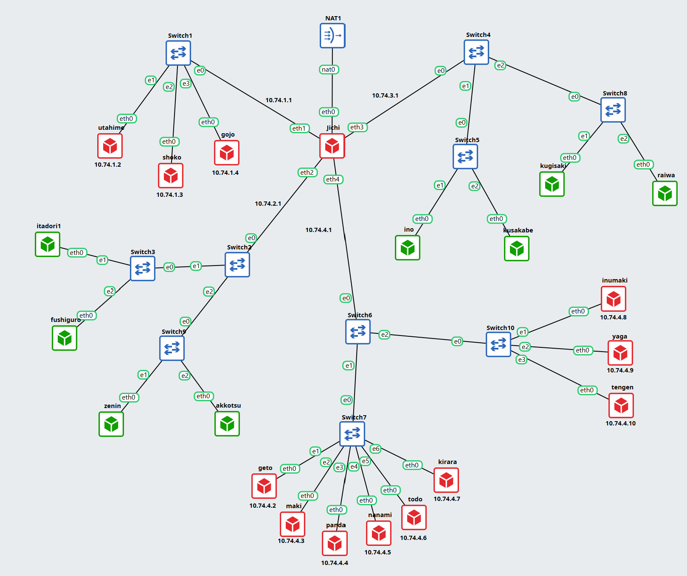

# Jarkom-Modul-3-2026-K-21

| Nama                          | NRP        |
| ----------------------------- | ---------- |
| Revalinda Bunga Nayla Laksono | 5027251011 |
| Najla Tufailah                | 5027251078 |


## 1
**Ketika Curtain menutup Shibuya, jalur komunikasi antar zona Jujutsu High terputus. Pulihkan konektivitas dasar dengan mengonfigurasi jichi: eth0 memperoleh WAN dari NAT, sedangkan eth1–eth4 menjadi gateway Network 1–4 sesuai tabel pemetaan. Aktifkan IPv4 forwarding dan source NAT, lalu tetapkan IP statis host infrastruktur sesuai tabel spesifikasi. Buktikan konektivitas setiap host ke gateway dan akses eksternal dari host yang relevan.**
## 1.1 Tujuan
 
1. Mengonfigurasi **jichi** sebagai router utama: `eth0` mendapat WAN dari NAT, `eth1`-`eth4` menjadi gateway Network 1-4.
2. Mengaktifkan **IPv4 forwarding** dan **source NAT** pada jichi.
3. Menetapkan **IP statis** pada host infrastruktur sesuai tabel pemetaan.
4. Membuktikan konektivitas tiap host ke gateway dan akses eksternal dari host yang relevan.
## 1.2 Tabel Pemetaan
 
### 1.2.1 Interface jichi
 
| Interface | Terhubung ke | IP Address | Keterangan |
|---|---|---|---|
| eth0 | NAT1 | DHCP | WAN |
| eth1 | Switch1 | 10.74.1.1/24 | Gateway Network 1 (DMZ) |
| eth2 | Switch2 | 10.74.2.1/24 | Gateway Network 2 (Divisi A) |
| eth3 | Switch4 | 10.74.3.1/24 | Gateway Network 3 (Divisi B) |
| eth4 | Switch6 | 10.74.4.1/24 | Gateway Network 4 (Data Center) |
 
### 1.2.2 Host infrastruktur (IP statis)
 
| Host | Peran | Network | IP Address | Gateway |
|---|---|---|---|---|
| utahime | DNS Master | 1 | 10.74.1.2/24 | 10.74.1.1 |
| shoko | DNS Slave | 1 | 10.74.1.3/24 | 10.74.1.1 |
| gojo | Public Reverse Proxy | 1 | 10.74.1.4/24 | 10.74.1.1 |
| geto | Internal Load Balancer | 4 | 10.74.4.2/24 | 10.74.4.1 |
| maki | Worker Frontend | 4 | 10.74.4.3/24 | 10.74.4.1 |
| panda | Worker Frontend | 4 | 10.74.4.4/24 | 10.74.4.1 |
| nanami | Worker API Utama | 4 | 10.74.4.5/24 | 10.74.4.1 |
| todo | Worker API Utama | 4 | 10.74.4.6/24 | 10.74.4.1 |
| kirara | Worker API Cadangan | 4 | 10.74.4.7/24 | 10.74.4.1 |
| inumaki | Database Slave | 4 | 10.74.4.8/24 | 10.74.4.1 |
| yaga | Database Master | 4 | 10.74.4.9/24 | 10.74.4.1 |
| tengen | DHCP Server | 4 | 10.74.4.10/24 | 10.74.4.1 |
 
## 1.3 Langkah Konfigurasi
 
### 1.3.1 Konfigurasi jichi
 
Berkas `/etc/network/interfaces`:
 
```bash
auto eth0
iface eth0 inet dhcp
  up sysctl -w net.ipv4.ip_forward=1
  up iptables -t nat -A POSTROUTING -o eth0 -s 10.74.0.0/16 -j MASQUERADE
 
auto eth1
iface eth1 inet static
  address 10.74.1.1
  netmask 255.255.255.0
 
auto eth2
iface eth2 inet static
  address 10.74.2.1
  netmask 255.255.255.0
 
auto eth3
iface eth3 inet static
  address 10.74.3.1
  netmask 255.255.255.0
 
auto eth4
iface eth4 inet static
  address 10.74.4.1
  netmask 255.255.255.0
```
 
Penjelasan:
 
- `net.ipv4.ip_forward=1` membuat jichi meneruskan paket antar-interface sehingga berfungsi sebagai router.
- Aturan `MASQUERADE` pada chain `POSTROUTING` (tabel `nat`) mengubah alamat sumber paket dari `10.74.0.0/16` menjadi IP `eth0` saat keluar ke NAT (source NAT). `MASQUERADE` dipilih karena IP `eth0` diperoleh dari DHCP dan bisa berubah.
Instalasi iptables:
 
```bash
apt update && apt install -y iptables
```
 
### 1.3.2 Nameserver sementara (jichi dan seluruh node Debinet)
 
Sesuai persyaratan, nameserver `192.168.122.1` dipakai pada persiapan awal agar node dapat mengunduh paket:
 
```bash
cat <<EOF > /root/.bashrc
echo "nameserver 192.168.122.1" > /etc/resolv.conf
EOF
```
 
### 1.3.3 Konfigurasi IP statis host
 
Format `/etc/network/interfaces` (nilai `address` dan `gateway` mengikuti tabel 1.2.2):
 
```bash
# UTAHIME
auto eth0
iface eth0 inet static
  address 10.74.1.2
  netmask 255.255.255.0
  gateway 10.74.1.1
 
# SHOKO
auto eth0
iface eth0 inet static
  address 10.74.1.3
  netmask 255.255.255.0
  gateway 10.74.1.1
 
# GOJO
auto eth0
iface eth0 inet static
  address 10.74.1.4
  netmask 255.255.255.0
  gateway 10.74.1.1
 
# GETO
auto eth0
iface eth0 inet static
  address 10.74.4.2
  netmask 255.255.255.0
  gateway 10.74.4.1
 
# MAKI
auto eth0
iface eth0 inet static
  address 10.74.4.3
  netmask 255.255.255.0
  gateway 10.74.4.1
 
# PANDA
auto eth0
iface eth0 inet static
  address 10.74.4.4
  netmask 255.255.255.0
  gateway 10.74.4.1
 
# NANAMI
auto eth0
iface eth0 inet static
  address 10.74.4.5
  netmask 255.255.255.0
  gateway 10.74.4.1
 
# TODO
auto eth0
iface eth0 inet static
  address 10.74.4.6
  netmask 255.255.255.0
  gateway 10.74.4.1
 
# KIRARA
auto eth0
iface eth0 inet static
  address 10.74.4.7
  netmask 255.255.255.0
  gateway 10.74.4.1
 
# INUMAKI
auto eth0
iface eth0 inet static
  address 10.74.4.8
  netmask 255.255.255.0
  gateway 10.74.4.1
 
# YAGA
auto eth0
iface eth0 inet static
  address 10.74.4.9
  netmask 255.255.255.0
  gateway 10.74.4.1
 
# TENGEN
auto eth0
iface eth0 inet static
  address 10.74.4.10
  netmask 255.255.255.0
  gateway 10.74.4.1
```
## 1.4 Pengujian dan Pembuktian
 
### 1.4.2 Tes dari jichi
 
```bash
ping -c 2 10.74.1.1
ping -c 2 10.74.2.1
ping -c 2 10.74.3.1
ping -c 2 10.74.4.1
ping -c 2 8.8.8.8
ping -c 2 google.com
```


### 1.4.2 Tes dari todo
```bash
ping -c 2 10.74.4.1     # gateway
ping -c 2 8.8.8.8       # akses eksternal melalui NAT
ping -c 2 google.com    # resolusi DNS
```


## 2
**Konfigurasikan isc-dhcp-server pada [PREFIX IP].4.10. Deklarasikan Network 4 ([PREFIX IP].4.0/24) sebagai subnet lokal tanpa pool dinamis, lalu siapkan scope DHCP untuk Network 2 ([PREFIX IP].2.0/24) dan Network 3 ([PREFIX IP].3.0/24). Validasi konfigurasi dan pastikan service aktif tanpa error “No subnet declaration”**

## 3
**Permintaan alamat dari Divisi A dan Divisi B tidak dapat menyeberangi subnet secara langsung. Konfigurasikan jichi sebagai DHCP Relay menuju tengen ([PREFIX IP].4.10), menggunakan eth2 untuk Network 2 dan eth3 untuk Network 3. Buktikan bahwa client dari kedua subnet berhasil memperoleh lease melalui relay.**

## 4
**Agar tim Dev dan Support di Divisi A menerima jatah alamat yang berbeda, atur dua pool DHCP pada Network 2. Tetapkan Pool 1 ([PREFIX IP].2.10–[PREFIX IP].2.35) untuk itadori dan fushiguro, serta Pool 2 ([PREFIX IP].2.70–[PREFIX IP].2.95) untuk zenin dan okkotsu. Rentang [PREFIX IP].2.36–[PREFIX IP].2.69 tidak boleh dialokasikan. Karena seluruh client berada pada subnet yang sama, gunakan DHCP class berdasarkan MAC Address atau Client ID untuk memisahkan kedua kelompok.**

## 5
**Setiap tim lapangan memiliki durasi operasi yang berbeda. Pada Network 3, berikan short lease 30 menit (1800 detik) kepada ino dan kusakabe, serta long lease 12 jam (43200 detik) kepada miwa. Gunakan pool short lease [PREFIX IP].3.10–[PREFIX IP].3.89 dan pool long lease [PREFIX IP].3.100–[PREFIX IP].3.199. Sesuaikan default-lease-time dan max-lease-time untuk setiap kelas client. Berikan pula DHCP options berupa DNS [PREFIX IP].1.2 dan [PREFIX IP].1.3, serta domain-search <xxxx>.com.**

## 6
**Kugisaki ditetapkan sebagai personel VIP yang harus mempertahankan alamat yang sama setiap kali terhubung. Buat DHCP static lease berdasarkan MAC Address client tersebut dengan fixed address [PREFIX IP].3.99. Pastikan alamat ini berada di luar seluruh pool dinamis, validasi konfigurasi server, lalu renew lease pada client. Buktikan bahwa alamat yang diterima sesuai dengan reservasi.**

## 7
**Setelah aturan alokasi diterapkan, pastikan setiap client menerima konfigurasi jaringan sesuai wilayahnya: subnet mask 255.255.255.0 (/24), gateway dan broadcast address yang benar, DNS [PREFIX IP].1.2 serta [PREFIX IP].1.3, dan domain-search yang ditentukan. Periksa IP address dan routing seluruh client Divisi A dan Divisi B, kemudian cocokkan lease dengan /var/lib/dhcp/dhcpd.leases pada tengen. Pastikan tidak ada alamat yang bertabrakan atau berada di luar kebijakan pool.**

## 8
**Sebelum Curtain dibuka kembali, buktikan bahwa proses pemberian alamat berjalan sesuai protokol. Lakukan packet capture saat salah satu client Network 2 atau Network 3 meminta lease baru. Gunakan tcpdump pada tengen atau jalur menuju Data Center untuk menunjukkan urutan DHCPDISCOVER → DHCPOFFER → DHCPREQUEST → DHCPACK. Identifikasi alamat server, alamat yang diberikan, lease time, dan field giaddr. Pastikan nilai giaddr sesuai dengan interface jichi yang menerima request dari subnet client.**

## 9
**Sebuah gangguan memutus jalur relay dan membuat permintaan alamat tidak sampai ke Data Center. Hentikan service DHCP Relay pada jichi, lalu paksa salah satu client di Network 2 atau Network 3 meminta lease baru dan catat gejalanya. Pulihkan service relay, ulangi permintaan DHCP, lalu buktikan bahwa client kembali memperoleh alamat dari pool yang benar dengan gateway semula.**

## 10
**Setelah gangguan Shibuya tertangani, pastikan pemulihan bertahan setelah restart. Aktifkan autostart DHCP Server pada tengen dan DHCP Relay pada jichi, lalu restart kedua node. Verifikasi status layanan, IP, gateway, lease, dan konektivitas client Network 2–3. Pastikan kebijakan Pool 1, Pool 2, short lease, long lease, dan fixed address tetap berlaku.**

## 11
**Utahime dan Shoko ditugaskan membangun sistem penamaan domain resmi agar seluruh pos tidak perlu menghafal alamat IP mentah. Konfigurasikan BIND9 pada utahime sebagai DNS Master dan shoko sebagai DNS Slave untuk mengelola domain jujutsu.<xxxx>.com. Atur SOA record, NS delegasi untuk kedua server, dan terapkan allow-transfer dari Master ke Slave. Pastikan file zona berhasil tersinkronisasi otomatis ke shoko saat nomor serial di utahime dinaikkan, lalu buktikan dengan melakukan query dig ke kedua server dari salah satu client.**


## 12
**Peta domain harus memetakan pintu masuk utama dan tetap bisa mencari alamat di luar kawasan Shibuya. Pada utahime, buat A record jujutsu.<xxxx>.com yang mengarah ke gojo, serta CNAME www yang merujuk ke domain utama tersebut. Buat pula Reverse DNS (zona PTR) untuk melacak IP gojo kembali ke domain resminya, dan aktifkan fitur DNS Forwarder pada BIND9 mengarah ke IP gateway internet (192.168.122.1). Uji dari client dengan dig untuk mengecek CNAME, PTR, dan buktikan client tetap bisa melakukan ping ke domain internet seperti google.com.**

## 13
**Kepala Sekolah Yaga dan Inumaki mendirikan database terpusat yang redundan agar log aktivitas kutukan tetap aman tersimpan. Konfigurasikan MariaDB pada yaga sebagai DB-Master dan inumaki sebagai DB-Slave. Buat database db_shibuya_<xxxx> beserta tabel request_logs di Master, aktifkan binary logging (log-bin, server-id), lalu hubungkan inumaki sebagai Slave yang menyalin data secara realtime dengan CHANGE MASTER TO. Berikan hak akses remote bagi seluruh node di Network 4, lalu buktikan replikasi berhasil dengan memasukkan data baru di Master dan memeriksa hasilnya di Slave.**

## 14
**Para penyihir lapangan bersiaga di Data Center sebagai pekerja backend untuk memproses aplikasi. Pasang Nginx dan PHP-FPM pada maki dan panda untuk menyajikan web frontend yang menampilkan hostname masing-masing. Pada nanami, todo, dan kirara, siapkan layanan API yang mencatat log request ke database yaga. Konfigurasikan virtual host agar worker merespons domain layanan yang ditentukan. Batasi akses langsung dari klien ke worker, web worker hanya menerima trafik melalui jalur proxy web yang ditentukan, sedangkan worker API hanya menerima trafik melalui geto. Uji bahwa akses langsung dari klien ditolak, sementara akses melalui reverse proxy tetap berhasil.**

## 15
**Geto bertugas mengendalikan pembagian beban request API di internal Data Center agar server tidak tumbang bersamaan. Konfigurasikan Nginx pada geto sebagai Load Balancer internal dengan upstream api_cluster yang mengarahkan trafik ke nanami dan todo. Terapkan algoritma Weighted Round Robin dengan bobot 3:1, di mana nanami menerima porsi beban tiga kali lebih banyak daripada todo. Buktikan distribusi beban ini dengan melakukan loop request berulang kali ke geto dari jaringan lokal Data Center dan periksa rasio responnya.**

## 16
**Gojo berdiri di perbatasan DMZ sebagai gerbang publik tunggal bagi seluruh client dari luar maupun dalam. Konfigurasikan Nginx pada gojo untuk melayani domain jujutsu.<xxxx>.com dan www.jujutsu.<xxxx>.com menggunakan metode Path-Based Routing. Atur agar request root (/) diteruskan secara Round Robin ke worker frontend (maki dan panda), sedangkan request ke path /api diteruskan langsung ke geto. Uji dari client Divisi A atau B bahwa akses ke web utama dibalas oleh Maki/Panda, sedangkan akses ke /api diteruskan dan dijawab oleh Nanami/Todo.**

## 17
**Komando pusat perlu mengetahui IP asli klien yang mengirimkan request tanpa tertukar dengan IP proxy perantara. Konfigurasikan gojo dan geto agar meneruskan informasi alamat klien melalui header X-Real-IP dan X-Forwarded-For. Pastikan geto hanya mempercayai informasi alamat klien yang diterima dari proxy terpercaya, dan skrip API menyimpan alamat klien yang telah diverifikasi ke kolom client_ip pada tabel request_logs di database yaga. Uji dengan mengirimkan request dari klien Network 2 dan Network 3 ke endpoint /api, kemudian periksa database untuk memastikan alamat yang tercatat sesuai dengan IP klien asal, bukan IP gojo atau geto.**

## 18
**nanami dan todo merupakan worker API utama, sedangkan kirara disiapkan sebagai worker cadangan. Konfigurasikan upstream api_cluster pada geto agar kirara menjadi server backup, serta terapkan passive health check dengan parameter max_fails=2 dan fail_timeout=5s pada worker API utama. Pastikan kirara menjalankan layanan API yang kompatibel dengan endpoint utama. Simulasikan gangguan dengan menghentikan layanan Nginx atau layanan API pada nanami dan todo. Buktikan dari klien bahwa request ke /api dialihkan ke kirara dan menghasilkan respons API yang valid tanpa error 502 Bad Gateway.**

## 19
**gojo bertugas mengoptimalkan layanan web sekaligus membatasi request berlebihan. Konfigurasikan Nginx Proxy Caching untuk halaman web frontend dengan masa berlaku cache 10 menit dan tambahkan header X-Cache-Status. Terapkan rate limiting pada path /api dengan batas 10 request per detik per IP klien. Buktikan bahwa request ke halaman web yang memenuhi syarat cache menghasilkan status MISS pada akses awal dan HIT pada akses berikutnya. Uji rate limiting secara terpisah dengan mengirimkan request beruntun ke /api, kemudian catat status respons yang dihasilkan ketika batas terlampaui.**

## 20
**Sebelum Curtain di Shibuya resmi dibuka, Kusakabe memimpin audit untuk menguji kapasitas layanan. Dari terminal kusakabe, jalankan benchmark menggunakan Apache Benchmark dengan parameter -n 600 -c 30 menuju http://jujutsu.<xxxx>.com/. Catat Requests per Second (RPS), latensi, dan jumlah request yang gagal. Lakukan pengujian tambahan pada endpoint /api untuk mengamati efek rate limiting. Bandingkan hasil pengujian baseline dengan hasil ketika rate limiting aktif, serta gunakan access log gojo untuk membedakan kegagalan aplikasi, koneksi, dan request yang ditolak oleh kebijakan rate limit.**


